# Everything SomniBot does

[← Back to the overview](README.md) · [The store](STORE.md) · [Commands](COMMANDS.md)

The screenshots on this page come from a real SomniBot install with sample names.

- [Your brand, everywhere](#your-brand-everywhere)
- [Setting up your server](#setting-up-your-server)
- [Server settings and role appearance](#server-settings-and-role-appearance)
- [Events and stages](#events-and-stages)
- [Emoji, stickers and sounds](#emoji-stickers-and-sounds)
- [Linked roles](#linked-roles)
- [Member gate and verification](#member-gate-and-verification)
- [Channel permissions](#channel-permissions)
- [Welcome and goodbye](#welcome-and-goodbye)
- [Moderation](#moderation)
- [Levels and XP](#levels-and-xp)
- [The coin economy](#the-coin-economy)
- [Seasons and battle passes](#seasons-and-battle-passes)
- [Pets](#pets)
- [Clans](#clans)
- [Collectible cards](#collectible-cards)
- [RPG and dungeons](#rpg-and-dungeons)
- [Play-money stocks](#play-money-stocks)
- [Housing and businesses](#housing-and-businesses)
- [Multiplayer games, party adventures and boss raids](#multiplayer-games-party-adventures-and-boss-raids)
- [Giveaways, polls and predictions](#giveaways-polls-and-predictions)
- [The assistant](#the-assistant)
- [Tickets](#tickets)
- [Music](#music)
- [Community tools](#community-tools)
- [Feeds and free-game alerts](#feeds-and-free-game-alerts)
- [Extras and integrations](#extras-and-integrations)
- [Automations](#automations)
- [Channels and messages](#channels-and-messages)
- [Staying in control](#staying-in-control)
- [Owner alerts and the daily digest](#owner-alerts-and-the-daily-digest)
- [Search, reports and insights](#search-reports-and-insights)
- [Your team](#your-team)
- [Languages](#languages)
- [Privacy](#privacy)

---

## Your brand, everywhere

SomniBot is white-label. Members talk to the bot application you create, with the name
and picture you give it. The **Branding** page sets:

- your **brand name**, used in the bot's messages, the store and the customer portal;
- **the bot in your server**: its own name, profile picture, banner and About me in each
  server, set separately from your other servers. SomniBot puts them back if Discord
  drops them;
- a **logo**, a **header image** and a **background** for the customer portal;
- a **primary colour** and an **accent colour**. Errors, warnings and successes always
  stay red, amber and green, so members read them the same way in every server;
- the **voice style** of the bot's stock lines (refusals, errors, welcomes, level-ups and
  giveaway wins). Your own custom messages are never changed;
- the **"Powered by SomniBot"** footer credit, which you can switch off.

**Bot presence**, in Settings, sets the messages shown under the bot's name in Discord;
they rotate with your member count, how long the bot has been online and the song
playing.

A **live preview** shows your saved messages in your brand. The dashboard is for you and
your team only: the bot's messages to members never mention it. Members use the
customer portal for purchases and a separate verification page for Linked roles.

Discord message cards (Components V2) combine branded text, pictures, sections and
buttons across store receipts, verification, moderation, community, economy and
music messages. Saved classic message templates keep their format until edited;
Discord's native polls use Discord's own voting interface.

## Setting up your server

**Server setup** designs the roles and channels SomniBot looks after, in seven steps:

1. **Bot status**: checks the bot is in your server and ranked high enough.
2. **Roles**: in five tiers (Admin, Moderator, Support, Member and Cosmetic), with your
   names and colours. Support is for staff who handle tickets and staff channels but have
   no moderation powers. A **Tier** choice on each role moves it to another tier and keeps
   its colour, icon and channel access. Editing a role's colours is quicker: the editor
   opens right under that role. Roles that already exist can be shown separately in the
   member list, or not.
3. **Channels**: categories and channels, each with who can open it (verified members,
   members before verification, or staff only).
4. **Review**: every change before it happens, including anything that would stop the
   deploy, such as the bot's role not being high enough. By default it only changes roles
   and channels SomniBot made before, and keeps everything you made yourself.
5. **Deploy**: the bot creates everything, applies Discord's server settings, the AutoMod
   spam and slur filters and Community, and the page follows its progress.
6. **Verification**: exactly what to look at in Discord, ideally with a test account.
7. **Go live**.

Run it again any time to change the plan, or start over with an empty plan. You can also
export a plan to a file and import a layout, and duplicate a channel. Nothing changes in
Discord until you deploy.

**Start with a ready-made layout.** Instead of an empty plan, pick one of eight starter
layouts: **Community**, **Gaming**, **Creator**, **Store**, **Support**, **Study**,
**Roleplay** or **18+ community**. Each is a complete plan with the Unverified and Member
roles, rules and verify channels, a staff area and channels that suit that kind of server.
Loading one asks first and replaces the plan on the page. It changes nothing in Discord and
does not turn on the member gate; edit anything you like, then Review and Deploy as usual. The deploy says plainly that members without the layout's roles
see no channels until the member gate is turned on, and **Go live** is offered right on
the result, with the gate's roles and verification channel filled in from your plan.

On a server that already has its own channels and roles, **Remove the channels and roles
that aren't part of this layout** (off by default, and only the owner sees it) deletes
the rest. The review lists exactly what would go, SomniBot saves a copy of the server
first, and a second confirmation is needed. Anything the layout uses, and anything
Discord or SomniBot needs, is never removed.

The channel editor includes text, announcement, forum, media, voice and stage
channels (media channels are offered only where Discord allows them). Forum settings include tags, default reaction, layout, guidelines and
post slowmode; voice settings include bitrate, region, video quality and member
limits. Community and boost requirements are shown where needed. **Only these roles**
lets you choose channel access using roles from your plan or existing Discord roles,
such as Server Booster. Missing roles appear as Review problems before deployment.
Your edits to a channel are kept when you pick another one. **Load a server template**
imports a template into the plan; it changes nothing in Discord until you deploy. Sync
and snapshots include these settings.

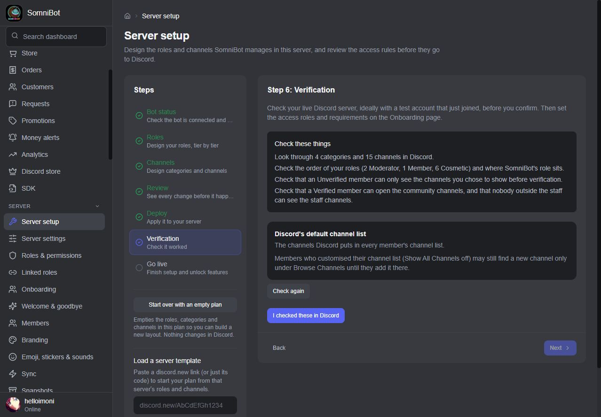

## Server settings and role appearance

**Server settings** controls the server's name and images, description, verification
and media filtering, notifications, AFK channel and timeout, system messages, safety
alerts, welcome screen, boost progress bar, Community, Discovery and widget. It
reads Discord's current values, explains unavailable features and records reversible
changes in **Admin changes**. It also shows whether 2FA for moderator actions is on; only
the server owner's own account can switch that, so it tells you where in Discord to do it.
The widget warns before exposing online members' names and pictures; vanity URLs are
read-only here.

Role appearance includes one emoji or a PNG/JPEG icon up to 256 KB, two-colour
gradients and holographic colours. Icons need boost level 2; enhanced colours need
boost level 3. Unavailable looks are explained while the rest of the role can still
be applied. The saved plan, Sync and snapshots keep the role's icon and colours.

**Give a role to members who wear this server's tag** adds or removes the chosen role
as members change their tag. It only takes back roles the bot gave for that tag;
roles assigned by hand stay in place. Default Member-tier permissions include
Activities and external sounds, applied through a Server setup deploy.

## Events and stages

**Events** creates, edits, starts, ends and cancels Discord scheduled events in voice,
on a stage or at an external location, with images, recurrence and interested counts.
Starting a stage event opens the stage, with a notification choice; ending it closes
the stage. Events made by hand in Discord are listed too and left alone unless you
edit them. Giveaways and scheduled messages can also appear as Discord events.
Automations can respond to an event starting or ending and a member marking interest.

## Emoji, stickers and sounds

**Emoji, stickers & sounds** uploads, renames and deletes the server's expressions,
showing usage against Discord's limits. Deleting asks for confirmation and explains
that it cannot be undone.

## Linked roles

The Launcher's **Linked Roles** check verifies the public verification address,
registered member facts and Discord sign-in redirect. Until the setup is ready, the
page shows what is missing and keeps new facts from being switched on.

On **Linked roles**, choose which facts SomniBot shares: owning any or a specific
product, an active program licence, level, verification and days in the server. In Discord's
**Server Settings → Roles → Links**, choose what each role requires, including its
minimum level or days. Members link through Discord and sign in with their account;
the bot refreshes their values as purchases, refunds and membership change.

The Launcher also checks **Install to a member's account**. This makes `/portal`,
`/privacy` and `/mydata` available in their DMs with the bot and in group chats. A private
server picker chooses which shared server an answer concerns when there is more
than one. Every other command stays server-only.

## Member gate and verification

New members get the **Unverified** role when they join and can open only the rules,
verification and support channels. When they finish your steps they get the **Verified**
role and the rest of the server. While they wait they can still ask for help: `/ask`,
`/help` and their own tickets work in the support channel. You choose the steps:

- the rules step: SomniBot's **I accept** button, Discord's Rules Screening, or a role
  members pick;
- roles they must pick from your reaction-role or button-role messages;
- Discord's own onboarding questions, which SomniBot saves to Discord and reads back.
  You can also give a role for an onboarding answer;
- an optional **challenge**: a **question** you write, with the answers you accept, or an
  **image captcha**. You choose how many attempts a member gets, from 1 to 20, and a
  challenge runs out after 15 minutes. You set it under **Safety and logs** on the
  Moderation pages.

New members get a DM with your opening line and numbered steps linking to your real
channels; if their DMs are closed, the note is posted in a channel instead. Members who
leave and come back go through the steps again, and you choose whether they get back the
roles and level rewards they had.

The **Member gate** box shows whether the gate is on, how many members are waiting and
verified, and every problem the bot's last check found, with **Check again** and **Repair
setup**. Turning the gate on or off shows exactly what will happen first, and members
already in the server keep their access.

**Nobody is let in by a timer.** Staff let someone in with `/verify`, or with **Verify** on
the **Members** page.

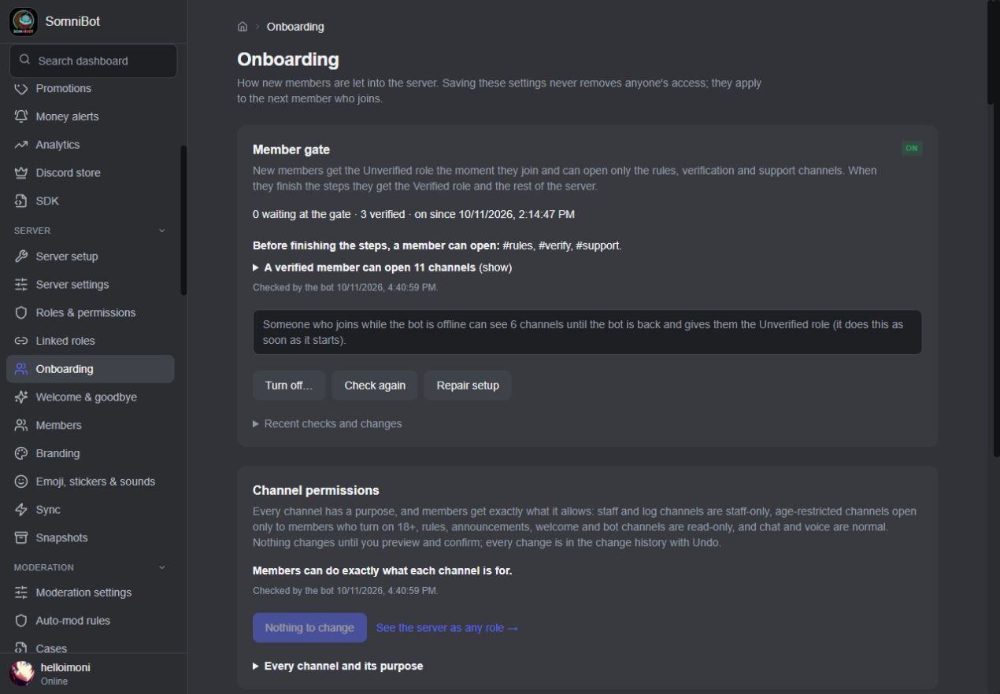

## Channel permissions

Every channel has a purpose, and members get exactly what it allows: staff and log
channels are staff-only, age-restricted channels open only to members who turn on 18+,
rules, announcements, welcome and bot channels are read-only, and chat and voice are
normal. Nothing changes until you preview and confirm, and every change can be undone.

- **Looks private: lock it?** lists channels every member can open today that look like
  staff channels.
- The **18+ role** opens age-restricted channels; members turn it on themselves with a
  button in the verification channel.
- **See the server as a role**: pick one or more roles and see, channel by channel, what
  someone holding them can do, with a fix for anything that doesn't match.
- **Staff-only history stays private.** Opening a channel only staff could read would
  show members every earlier message in it, so SomniBot refuses, names the channel and
  asks you to choose: make a new channel for members, or go ahead.

## Welcome and goodbye

- A **welcome message** with variables (`{user}`, `{user.name}`, `{server}`,
  `{memberCount}`, `{memberNumber}`, `{level}`) and a **branded welcome card** with the
  member's avatar and name, or message only, or card only.
- A **welcome DM** with a numbered "where to start" list linking your real channels.
- **Automatic roles** for new members, given once they get access.
- A **goodbye message**, with an optional goodbye card and the time they spent in the
  server.

The welcome runs once per member, when they get access: after the member gate if it's
on, or when they join if it's off. A member who leaves and rejoins over and over gets one
welcome and one goodbye per 30 minutes, not one each time.

## Moderation

- `/warn`, `/mute` (a Discord timeout), `/kick`, `/ban`, `/purge`, `/infractions` and
  `/pardon`, plus **Warn User** on the right-click menu.
- **Automatic punishments**: what happens as a member collects warnings. Warnings expire
  after the number of days you set, but stay in the history.
- **Cases**: every warning, timeout, kick and ban, with action or pardon.
- **Appeals**: members appeal with `/appeal`; you approve or deny on the dashboard.
- **Punishments and purchases**: a ban suspends a buyer's purchases instead of revoking
  them, and gives them back if the ban is pardoned. After a kick, purchases are kept and
  roles come back when they rejoin.
- **Message logging** of edits and deletes, **auto-moderation** in Watch only or Enforce
  mode, and a **starboard** (a deleted message's copy is taken down, and an edited one is
  updated).
- **Case workbench**: **moderator notes** that only staff see, kept apart from cases;
  case reasons you can edit, with every earlier wording kept in a history; **CSV
  downloads** of cases and of notes; and **moderator activity**, how many actions each
  moderator took over a period you choose.
- **More logs**: pick a channel for each kind of event (role changes, channel changes,
  voice joins, leaves and moves, invite changes, nickname changes and avatar changes),
  plus a channel for incident reports. Each is optional, and an event with no channel
  sends no log.
- **Anti-raid** (off until you turn it on): watches for a flood of joins, acts, and can lift
  its raid bans afterwards. It never removes the server owner, administrators, bots or
  members who are already boosting. Before you turn it on, a box lists exactly who it
  removes, and warns that a kicked booster loses the boost for good.
- **Anti-nuke** (owner only, on from the start): stops one person from wrecking the
  server in seconds. The bot reads Discord's audit log as it happens and counts what each
  person does within a minute: channels or roles deleted, members banned or kicked,
  webhooks created, powerful permissions given to roles, bots added, and changes to the
  server name or vanity link. Giving powerful permissions to @everyone is stopped at
  once. You set every limit and the time window. When someone passes a limit, the bot
  saves a snapshot, takes powerful permissions back off the roles they were given, acts
  on the person as you chose (take away their powerful roles, the same plus a 24 hour
  time out, kick them, or only tell you), sends you one critical alert that names the
  snapshot from before it started, and records it in the change history. It never acts
  on the server owner, on the bot itself, or on the people and roles you mark as
  trusted. It can only act on someone whose top role is below the bot's, and when it
  can't, the alert says so.
- **Lockdown**: stops everyone with the Verified role posting, reacting, starting threads
  and speaking in every channel at once. Staff keep posting where their own roles allow,
  and the owner and Administrators are never locked. Optionally pause invites too.
  **Unlock** puts every channel back exactly as it was, even after a restart.
- **Panic button**: one press (**Panic: lock and open incident** on the dashboard, or
  `/lockdown panic-start`) applies the emergency lockdown you set up ahead of time, which
  can pause invites and new DMs and leave channels you name open, and opens an incident
  with a report for staff. **Undo panic and close incident** (or `/lockdown panic-undo`)
  puts everything back.
- **Invites**: who invites whom, how many joined, stayed or left, and pause, reopen,
  delete or make invites from the dashboard.

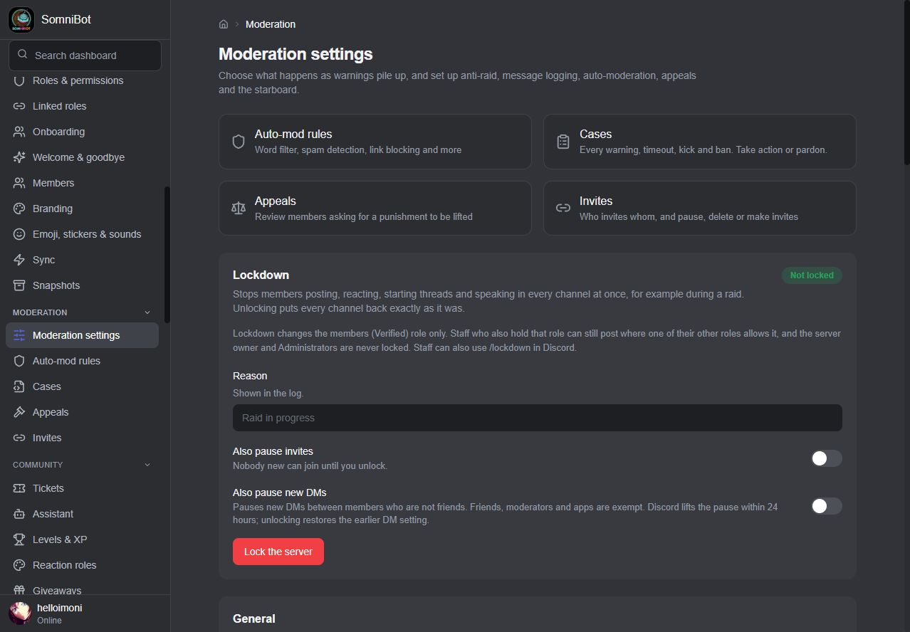

**Auto-mod rules** filter words (exact, wildcard or a custom pattern), links, invites,
spam and mass mentions. One burst of spam counts as one offence, not one warning per
message, and a pattern that would match every message is refused when you save it.
**Safety rules** add more kinds of check:

- **Phishing and scam links**, checked against a maintained list that SomniBot keeps a
  copy of and refreshes every 6 to 168 hours, as you choose;
- **Attachments**: blocked file extensions, allowed file types and a biggest file size;
- **Emoji spam**: too many emoji in one message;
- **Distorted (Zalgo) text**;
- **Text patterns** of your own, one per line.

Each safety rule can be limited to some channels or some roles, and can skip other
channels and roles. New rules are saved switched off, so you can try them first.
**Try a rule safely** checks a sample message, the channel and roles it would come from
and, if you like, an attachment's name, type and size against your saved rules: nothing is
sent and no case is recorded. A **Translator** rule rewrites words
instead of blocking them: the rewritten message is posted as the member, and it never
warns or punishes anyone.

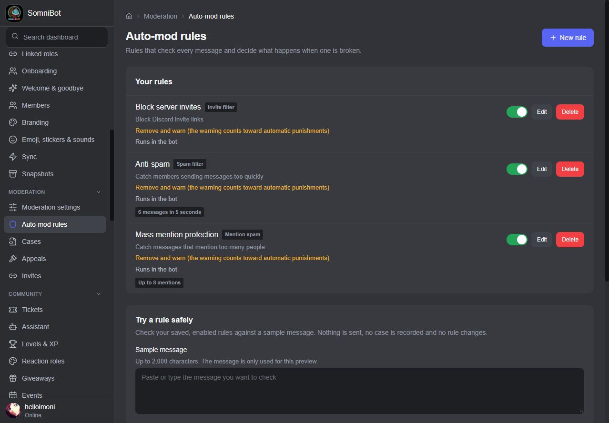

Staff can also use `/voice-mod` or a member's timeline to move, server-mute, deafen
or disconnect someone in voice. Each action is recorded as a moderation case.

Lockdown can **Also pause new DMs** until its displayed end time, for up to 24 hours.
Unlock removes the pause that lockdown set, preserving any earlier pause that is
still running.

## Levels and XP

- **Message XP** (a random amount between your minimum and maximum, with a cooldown) and
  **voice XP**.
- **Voice XP only for real activity**: not muted or deafened, with someone else in the
  room (streaming or camera makes no difference). Stage listeners earn nothing.
- Channels and roles that never earn XP, threads included.
- **XP multipliers** for roles.
- Your own **level curve**. New servers start on a gentler one; servers that already have
  a curve keep it.
- **Level-up announcements** with a rank card in your colour.
- **Level rewards**: a Discord role, coins or a game item at any level.
- A server **leaderboard** that lists only members still in the server, with the same
  place on `/rank`. Members use `/rank` and `/leaderboard`; staff adjust XP with `/xp`.
  Lowering a member's XP takes back the level reward roles they no longer qualify for,
  and raising it announces the level-up and hands out the rewards.
- **More leaderboards**: `/leaderboard` also ranks messages, voice time, currency earned,
  trivia wins, fish caught, the heaviest fish, achievements, quests, wealth, reputation,
  prestige and the daily streak, for all time, this or last week, and this or last month.
  While a season runs, its own period is offered too. A **public leaderboard page** on the
  web shows the same boards, and members who hid themselves are left out.
- **Profiles**: `/profile` shows a member's card. Members change how their own card looks
  (`/profile customize`), add pronouns, a birthday, a favourite or a link
  (`/profile fields`) and choose which achievements it shows (`/profile badges`). You set
  the default look and what members may change on **Profile cards**. Members can also
  sign in with Discord on the customer portal to see a **profile page** with their level,
  activity and progress, and to customize it. Another member's page is shown only if
  that member shared it.

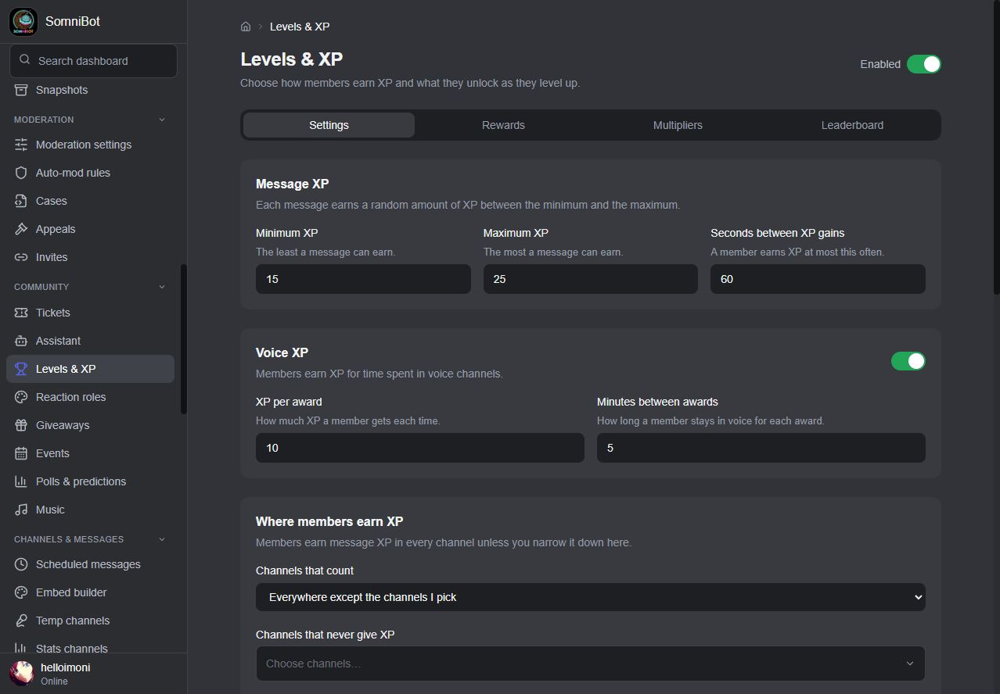

## The coin economy

A full play-money game, with its own pages for each part:

- **Earning**: daily, weekly and monthly rewards (`/claim daily`, `/claim weekly`,
  `/claim monthly`) with streak bonuses that top out after about 25 in a row;
  `/earn work`, `/earn crime`, `/earn beg` and `/earn search`; chat income; and **role
  income**, coins for holding a role, collected with `/claim income`. **Jobs** add a
  career: members hold a job, see their next promotion and apply for a better one with
  `/earn job`.
- **Banking**: wallet and bank, deposits and withdrawals, paying other members (`/bank`),
  robbing, and passive mode. The bank has a limit that members can raise with upgrades,
  pays interest and lends: `/bank loan` borrows play money and pays a loan back. A
  robbery steals at most 10,000, and a failed crime or a caught robber pays a fine from
  the wallet first, then the bank.
- **Gathering and making**: hunting, digging, mining, chopping wood and foraging
  (`/gather`), fishing, farming and crafting. Each gathering activity has a skill level
  that opens better finds, and today's biomes change what turns up. A **museum** rewards
  completed collections with a badge. Crafted **boosters** and flair show in
  `/craft boosters`. Tools wear out, and a worn tool sells for less.
- **Fishing** has weather and time of day (`/fish conditions`), different waters, record
  fish with titles for whoever holds them, and an **aquarium** where members show off
  their heaviest catches.
- **Farming** adds plot and growth upgrades, cooking crops into meals that give a short
  boost, and farm animals that you feed and collect from.
- **Spending and trading**: a game shop with your own items, and a member-to-member
  market (`/market`) with listings, **auctions** where the highest bid wins, direct
  **trades**, **wanted ads** that hold the coins until someone fills them, and a price
  guide. A market trade never costs less in fees than paying the same coins directly.
  Selling never loses coins: if the payout wouldn't fit under your wallet and bank limits,
  the sale is refused and nothing is sold.
- **Prestige** resets a member's coins for a permanent earning bonus, and unlocks a
  prestige-only shop with titles and medals.
- **Playing**: story adventures where a risky choice costs health and pays more, so
  healing items matter; crew heists, where a bigger crew improves the odds; pets that you
  feed, train and battle, whose perks grow with their level and pause while the pet is
  sick; a **pet egg** item that hatches a pet (a member who already has one feeds it
  instead); quests given at random each day and week, only for the games you have on;
  achievements with badges and rewards; prestige; trivia; lotteries and predictions.
  [Pets](#pets), [heists, party adventures and boss raids](#multiplayer-games-party-adventures-and-boss-raids),
  [clans](#clans), [cards](#collectible-cards), the [RPG](#rpg-and-dungeons),
  [stocks](#play-money-stocks) and [properties](#housing-and-businesses) have their own
  sections below.
- **Games**: coinflip, slots, dice, blackjack, scratch cards, guess the number,
  rock-paper-scissors and high-low, plus **roulette**, **crash**, **pet races** and
  member-versus-member **duels** (`/casino`). Slots come in five reel themes, which change
  the look and never the odds, and blackjack lets you split. Bets start at 10 coins. In
  `/casino highlow` the member sees a number from 1 to 100 and calls the next one higher or
  lower. Every right call climbs a ladder (×1.5, ×2, ×3, ×5, ×8, ×12) and the member can
  cash out on any rung or call again; a wrong call, or a tie, loses the bet. Every rung is
  priced so that cashing out anywhere gives back about 95% over time. If no one chooses in
  time the bet is refunded, and so is any open game after a restart. A small share of
  casino bets also grows a shared **progressive jackpot** that a slots spin can win; you set
  its starting amount and the share.
- **Economy health**: a page that shows whether your play money is in balance: how much
  there is, how fast it is growing and what to change.
- **A tutorial** that teaches new members how to use the bot.

Over time the games pay back about 95% of what is bet (heists about 95–96%). You set the
biggest bet per kind of game and a **daily loss limit**, which counts the net loss over the
last 24 hours. XP items can be used 5 times in any 24 hours.

**Coins are play money, kept apart from real money:** no store product gives coins, there
is no way to turn coins into real money, and a role someone paid for never earns coin
income.

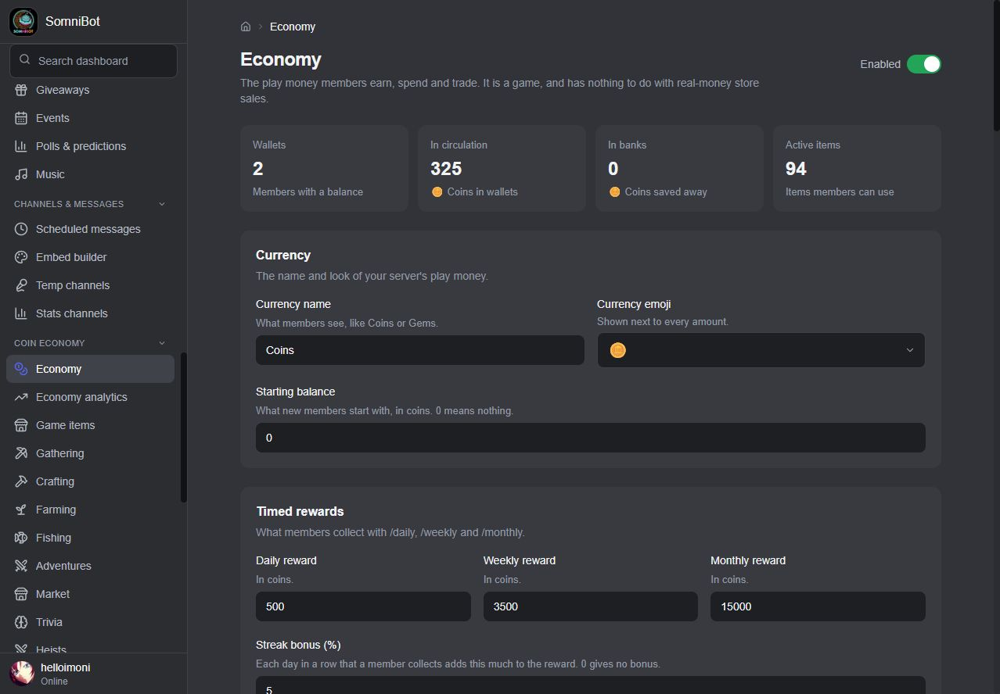

## Seasons and battle passes

Seasons give the coin economy a rhythm. Each season has its own **battle pass**, quests,
daily login calendar and badge, and seasons run back to back. Everything here is play
money and game progress; none of it is sold.

- **Four ready-made seasons** come with every server, each with its own theme, pass,
  rewards and badge, so a server has a full year without writing any. Add, edit, reorder
  or delete your own. A season runs 28 to 56 days, and a server can hold up to 24.
- **The pass** has up to 100 tiers, each with a free and a premium reward. Rewards can be
  coins, member XP, pass XP and game items.
- **Pass XP** comes from messages, voice minutes, coins earned, quests, trivia wins, games
  played, fish caught and achievements. You set what each is worth and the daily limit
  for messages and voice minutes.
- **Premium track**: you choose what unlocks it: server boosters (the default), a role
  you choose, everyone, or no one.
- **Season quests** (up to 12 a season), a **daily login calendar** of up to 60 days, and a
  **badge** members earn at the tier you choose.
- **Rotation**: when the last season ends, the rotation can start again from the first
  (on by default), unclaimed rewards can be claimed for members automatically, and a
  channel can announce each season. A finished run is kept as a record of what each member
  earned.
- Members use `/profile season` to see the pass (`view`, `tiers`, `quests`, `claim`,
  `daily` and `history`), and the season shows up as a period on the leaderboards.

## Pets

Members raise pets with `/pet`: buy one, feed it, play with it, train it and rename it.

- **Care**: a pet gets hungry and sad over time. You set what feeding and training cost,
  how fast they fall and when a pet counts as sad. A sick pet's perks pause.
- **Battles**: members battle each other's pets. The entry fee is the pot and the winner
  takes it, so battles never create coins. The same two pets can't fight again until a wait
  you choose has passed.
- **Growing up**: a high-level pet can **evolve** for permanent stat gains, and a
  top-level pet can **prestige**, starting again at level 1 for a permanent bonus.
- **Two pet slots**: members switch between them.
- **Expeditions**: send a pet out for loot, then collect what it found.
- A **pet egg** item hatches a pet.

## Clans

Members start and grow their own clans with `/clan`.

- **A clan of its own**: creating one gives it a role and a private clan channel. You
  choose the cost to create one, the biggest clan, the category the channels go in and
  whether members may start clans at all.
- **People**: invite, accept, leave, kick, promote officers, demote and hand over
  ownership. Open clans can be browsed and joined.
- **A shared bank** in play money: members deposit, owners and officers withdraw, and you
  can cap it.
- **Clan quests** each day, set by you or taken from the stock ones, and clan levels that
  grow with them.
- **Clan wars**: challenge another clan, accept or decline, follow the standings on a war
  leaderboard. You choose how long a war lasts.
- A clan can be disbanded once its bank is empty.

## Collectible cards

A card collection that is only a game: cards and rolls are never sold for real money and
can't be turned into money or store credit. Members use `/shop cards`.

- **Roll** with a free daily roll, or with play coins once the free ones are used; you
  choose which of those are on and the limits.
- **Claim** a card you rolled, before the deadline, if nobody owns it yet.
- **Collections and sets**: see your cards and how complete each set is, with one-time
  bonuses for finishing a set.
- **Trades**: offer one of your cards for another member's. Cards stay put until the other
  member accepts, and both change hands together.
- You manage sets and cards on **Collectible cards**. Stock sets come with the bot and
  your edits stay yours. Every picture you add needs a public web address, its source, its
  licence and its credit.

## RPG and dungeons

`/rpg` is a play-money RPG. Rewards are never for sale.

- **Four classes**: Vanguard, Ranger, Arcanist and Warden, each with different power,
  guard and vitality.
- **Gear** in three slots (weapon, armor and relic), and a **skill tree** with three
  branches: Assault, Guard and Utility.
- **Dungeons** that reuse your adventure stories and choices. Runs use dungeon energy,
  daily runs and cooldowns, and can be resumed.
- **Arena**: members challenge each other for play-money rewards, with no real-money
  stakes.
- **World boss**: dungeon and arena results also hit the shared weekly boss (see
  [boss raids](#multiplayer-games-party-adventures-and-boss-raids)).
- You switch the parts on or off, and set energy, limits and rewards, on **RPG**.

## Play-money stocks

`/shop stocks` is a stock and crypto game with **fictional assets** and play money. Nothing
in it is real, and nothing can be deposited, withdrawn or turned into real money.

- **Prices follow the server**: chat, voice, events and the economy move each asset's
  price at regular ticks. You choose how often, how far a price can move in one tick and
  how strongly activity and events push it.
- **Trading**: see the market, buy and sell shares, and check your portfolio with its
  cost and gain. A sale that wouldn't fit under a member's wallet and bank limits is
  refused before any shares move.
- **You run the market**: create stocks and crypto with a symbol, name, price, floor and
  ceiling, and a signal (chat, voice, events or economy). Halt an asset to pause orders;
  delist it for good with a final price, and holders cash out with `/shop stocks recover`.
- A trade fee, a biggest order and a most-shares limit, and an optional public
  **portfolio leaderboard**.

## Housing and businesses

`/shop property` lets members buy houses and businesses with play money.

- **Houses and businesses**: starting examples are a starter flat, a townhouse, a snack
  cart, an arcade and a night market. You can edit the prices and earnings.
- **Income** from a business builds up until a cap and is collected with `/shop property
  claim`. A multiplier pauses or boosts it, and a member can get a once-a-day DM when a
  business is full.
- **Upgrades and decorations**: improve a property, and add decorations and security
  items such as a security camera or a reinforced safe.
- **Defence**: the strongest property a member owns can cut what a successful robbery or
  heist takes. Defence wears down over time.
- A limit on how many properties one member can own.

## Multiplayer games, party adventures and boss raids

All wagers here use the play-money economy. They never charge a card, create store credit
or reach into real-money commerce.

- **Multiplayer tables and board games** (`/games create`, `join`, `move`, `status`):
  blackjack with up to five seats, Texas Hold'em and bingo, which can use bets; and
  tic-tac-toe, connect four, chess, hangman, Wordle, word chain and a guess race, which
  don't. A table reserves each seat's bet before play, status hides answer keys, decks and
  other players' private cards, and a repeated button press never pays or charges twice.
- **Music quiz** in voice: the host picks 5 to 30 songs, plays a short clip of each in the
  voice channel, and members score by naming the song.
- **Party adventures**: 2 to 4 members play a story together and vote on each choice
  (`/adventure party-create`, `party-join`, `party-begin`, `party-vote`). A server can
  also post a **weekly party adventure** on a day you pick. You build the story maps on
  **Party story maps**, and every map is checked for a start, reachable scenes and at
  least one ending.
- **Crew heists**: three stages (plan, break in, escape) with three roles. The hacker,
  the muscle and the driver help with one stage each. Members pay an entry fee, which is
  returned if the heist is cancelled. You manage the targets on **Heists**.
- **Weekly boss raids**: a boss appears on the day you choose, with the health and reward
  pool you set. Chatting, winning games and trivia, and dungeon and arena results hit it,
  and when it falls the reward is shared by contribution (`/raid status`, `/raid
  leaderboard`, `/raid claim`).

## Giveaways, polls and predictions

- **Giveaways** with an entry button, any number of winners, optional role and level
  requirements, a winner announcement and a congratulations DM. A prize can be a
  product from your store, delivered as an order like any purchase. The draw only picks
  people who are still in the server, aren't bots and still hold the required role.
  Staff can start, end, reroll, pause, resume and list giveaways from Discord.
- **Polls**: members make them with `/poll`. **Use Discord's poll** uses Discord's
  native voting interface, with a duration and multiple-answer choice; the dashboard
  reads the final counts when the poll ends.
- **Predictions**: members bet play money on what will happen, with `/predict`. The creator
  can set a time after which no more bets are taken, can't bet on their own prediction, and
  can cancel it, which refunds every bet in full. The house keeps 5% of the winnings (never
  of the stake), and you set the biggest bet.
- **Lottery**: the winner gets 90% of the pot and the other 10% is burned.
- **Trivia**: only the first three right answers in a round are paid, a member can win
  only 600 coins a day from trivia, and streak bonuses top out after 10 in a row. Staff
  can start a **daily question** or a ten-round **trivia night** and members see the
  scoreboard (`/casino trivia`). The built-in questions cover many topics, including music,
  movies and TV, video games, anime, sports, food, animals, mythology and space, and you
  can write your own questions on **Trivia**.

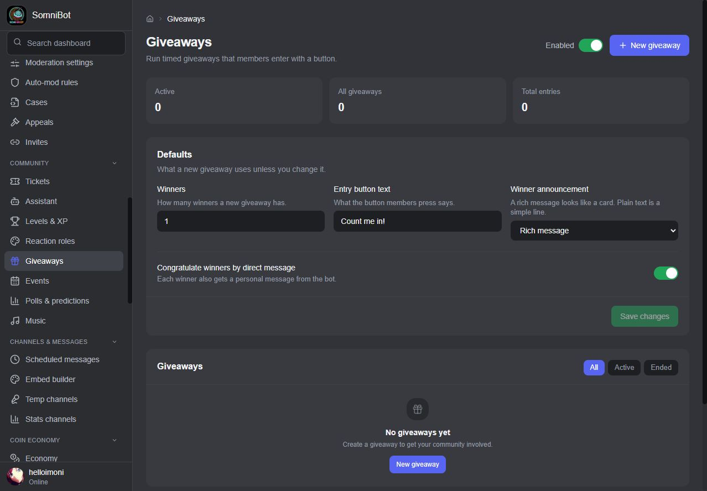

## The assistant

- Members ask in plain words: **`/ask`**, a **mention** of the bot, or a **help channel**
  where each question gets its own thread and follow-ups keep the conversation.
- It answers from your server **as the asking member sees it**: channels and what they
  can do there, roles and how each one is given, the features you switched on with their
  real numbers, the **rules and info your team posted**, pinned messages, your
  onboarding questions and scheduled events.
- **Your own answers come first**: write the answer to a common question once and the
  assistant uses your wording.
- With Google, answers can use **more server detail and conversation history**;
  providers with smaller allowances use a more compact view automatically.
- It **never names a channel the member can't open**, and in a public reply it only
  mentions what everyone reading can see.
- When it doesn't know, it says so and offers a **ticket**. Orders, payments and refunds
  go to the customer portal or a person, never a guess.
- In tickets it can **suggest an answer**; **I still need a person** calls your staff.
- **For your staff**: a short **brief** on a new ticket's staff alert (what the member
  needs and what the assistant already told them), **Draft a reply** in any ticket (post it
  or edit it first), a **summary** at the top of the transcript, and **translation** both
  ways when a member writes in another language.
- **For you**: **Ask about your setup** explains your own server in plain words ("why can't
  new members see #general?") with a link to the page that changes it; questions it
  couldn't answer can get a **drafted answer** you edit and save as your own answer, or
  dismiss and bring back later; the daily digest
  starts with **what matters today**.
- **For members**: **Translate** a message into their own language in a reply only they
  see, and a **personal welcome DM** based on eligible interest/onboarding roles. Your
  welcome template stays as written; without eligible roles, the normal welcome is sent.
- **Rate answers**: members press **Helpful** or **Not helpful** under an answer. The
  **Assistant coverage** report shows how much is rated and which questions still need an
  answer of your own, so you can write one.
- **Channel chat**: pick one channel where the assistant joins ordinary conversation, with
  a personality line you write. In its threads it remembers a short private history for
  each member. That history is part of a member's data export and is erased when they
  erase their data.
- Turn the optional tasks on or off on their own, choose the staff language and see usage
  by task. Member answers take priority; ordinary tickets, welcomes and digests still
  work without generated text when the service is busy or unavailable.
- Give it a **name, a personality and a voice** (professional, friendly or playful).
- **Try it** in the dashboard as any kind of member, and see the questions it couldn't
  answer so you can write your own answer.
- **When the AI service has a bad moment**, the assistant waits when the service says how
  long and asks again, and asks again after a server error. A server-wide limit of 40
  questions a minute keeps one busy hour from using up your allowance. Questions that
  failed because the service was down or not set up don't fill your list of unanswered
  questions: one line tells you when the outage was and how many members were affected.
- It runs on **your own free key** from Google AI Studio (the most room), Cloudflare Workers
  AI or Groq, or any OpenAI-compatible service. The Launcher walks you through making the key and checks
  it; the question and the server information used to answer it are sent to that
  service.

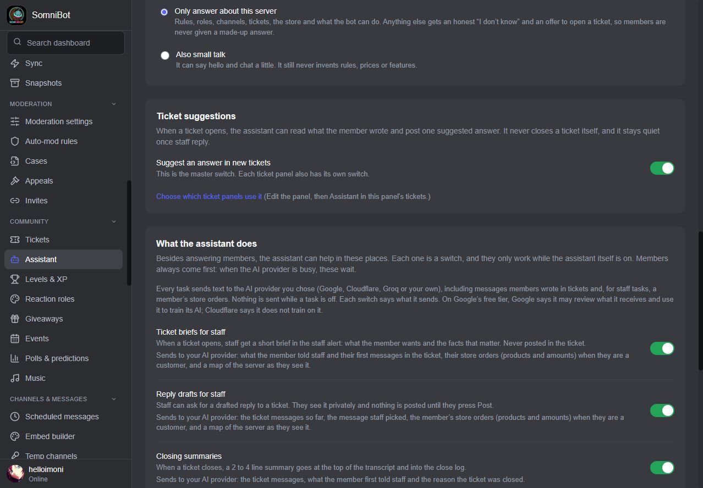

## Tickets

- **Panels** with buttons or a dropdown. Each ticket opens as a **private thread**.
- **Ticket types**, each with its own category, manager role and opening message. A type
  can be limited to the owner and administrators only, and its alert in the staff channel
  then hides the member's answers and buyer details.
- **Priority**: every ticket is low, normal, high or urgent. Each ticket type has a
  default priority, and staff change it in the ticket with `/ticket-staff priority`.
- **Saved replies**: write answers you give often once, under **Saved replies**, for every
  type or for one type, and drop one into a ticket with `/ticket-staff reply`.
- **Move a ticket** to another type on the same panel with `/ticket-staff move`.
- **Response targets**: for each ticket type, set how many minutes staff have to give a
  first reply. If nobody has by then, staff are reminded in the ticket, and you can add a
  second, escalated reminder after a further wait of your choosing. Leave the target empty
  to switch reminders off for that type.
- **Ticket stats**: average rating and how the ratings spread, first-response and
  resolution times (average and median), tickets by type and what each staff member
  answered and resolved, for the last 7 days, 30 days or other periods, with a download as
  a file.
- An **intake form** of up to five questions, asked before the ticket is created. Each
  ticket type can have its own questions (for example, Order help asks for the order
  number); a type without any uses the panel's form.
- A **staff alert** for each new ticket, with **Join ticket** and **Claim** buttons. A
  claimed ticket can be handed back with **Unclaim**, and a closed one reopened with
  **Reopen** or `/ticket-staff reopen`.
- **A ticket never goes unseen.** If nobody holds the staff role yet, the server owner and
  administrators are added to the ticket, named in it and pinged in the staff alert.
- Limits on open tickets per member (the limit is checked before the form opens, and a
  member who opens and closes tickets too fast is asked to wait a few minutes), a reminder
  and auto-close after silence, and **feedback** when a ticket closes. When the member
  wrote last, they get no reminder and the ticket isn't auto-closed; the team gets a nudge
  instead.
- **Transcripts**: one web page with the whole conversation and its files, with an
  optional copy for the member.
- **Buyer context**: when the member has bought from your store, staff see their orders,
  the PCs they activated your programs on and open portal requests, and can **reset
  PCs**, **start a refund** or **remove access** from inside the ticket. A refund
  requested by staff goes to the owner to approve. For paid service orders, staff can also
  set where the work stands (not started, in progress, waiting on the buyer or delivered)
  with a note, and the buyer is told, and can **bill the buyer an extra amount** after a
  confirm step.
- **Members who leave**: staff are told when a member with an open ticket leaves the
  server, and the member is added back to the ticket if they return.

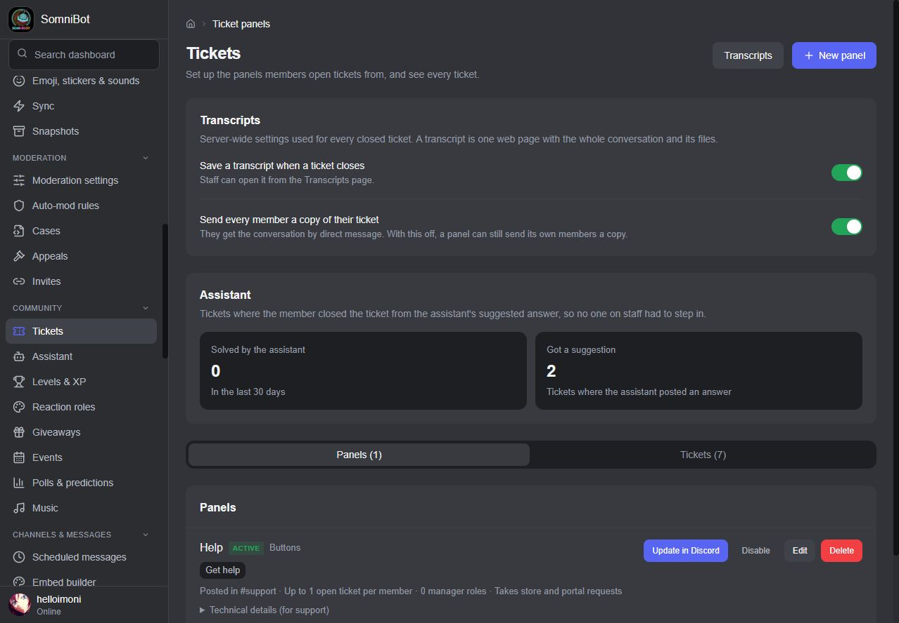

## Music

Play from **YouTube, SoundCloud, Bandcamp and Twitch** in your voice channels.

- A **DJ role**. Anyone in the bot's voice channel can add songs and skip their own;
  skipping someone else's song needs a vote from the people listening.
- Music voice channels, starting volume, and limits on queue size and songs per member.
- **Audio effects**, loop, shuffle, seek and moving songs in the queue. Members can move
  and remove the songs they added themselves.
- **Autoplay** (off until you switch it on): when the queue runs out, the bot keeps
  playing related songs, never repeats a recent one, and marks them "Picked by Autoplay".
  `/music autoplay` turns it on or off for the music that is playing.
- **`/music previous`** plays the song before this one again, and **`/music skipto`** jumps
  ahead to a song in the queue; passing over someone else's song needs the same listener
  vote as `/skip`.
- **Lyrics**: `/music lyrics` shows the lyrics of the song that is playing, from the
  provider you set up in the Launcher. You can switch lyrics off.
- **Search and pick**: `/music search` lists matching songs and lets the member choose
  one. You decide how many choices appear, from 3 to 10.
- **24/7 mode**: `/music 24-7` keeps the bot in the voice channel between songs and after
  the channel empties, until it is switched off. Members with the DJ role (or admins) can
  change it.
- **Playlists**: save the current queue as a **server** or **personal** playlist, add one
  to the queue later, list them and delete them (`/music playlist`).
- **Music quiz**: a host-run game in voice where members name the song (see
  [multiplayer games](#multiplayer-games-party-adventures-and-boss-raids)).
- Songs that have already played no longer use up queue places, and the player keeps the
  queue and the song after a restart. A finished song's card loses its buttons.
- Leaves an empty channel or an idle player on its own.
- A **Music server and YouTube** check that says whether music is working.

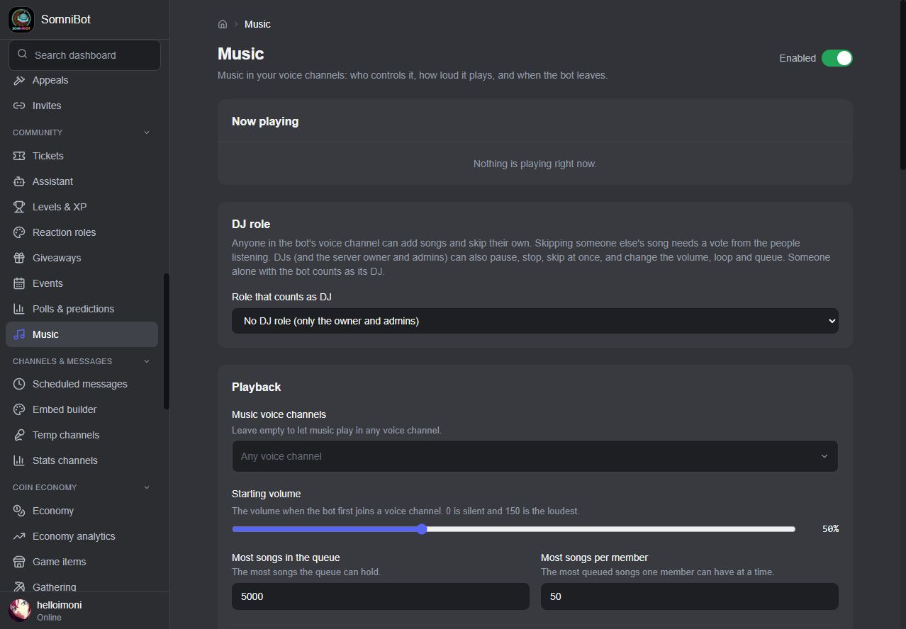

## Community tools

Small features that make a server feel lived in. Each has its own page and switch.

- **Suggestions** (`/suggest`): members share ideas and everyone votes with 👍 and 👎.
  Staff approve, consider, deny or mark an idea as implemented. You can have staff review
  each one before it is posted.
- **Confessions** (`/confess`, off until you turn it on): members post anonymously. Staff
  review each one first in a staff review channel, or you let them post straight away.
- **Birthdays** (`/birthday`): members share the month and day, never the year. On the
  day, the server can announce it, give a birthday role and a gift of play money, and a
  **calendar** on the dashboard shows who is next. The server's time zone decides when a
  birthday starts and ends, and a birthday can trigger an automation.
- **Social and fun**: look someone up (`/info`), play 8-ball, choose, ship or rate
  (`/fun`), hug, pat, kiss, slap, cuddle or bonk with an anime GIF (`/action`), marry
  another member (`/marry`) and thank each other with rep points (`/rep`). There is
  nothing to set up, and you can switch each command off.
- **Utilities**: reminders that repeat (`/remind`), an away note (`/afk`), time zones
  (`/time`), saved snippets called tags (`/tag`), a private to-do list (`/todo`) and
  sticky notes that stay at the bottom of a channel (`/sticky`).
- **Starboards**: send different emoji to separate boards, each with its own channel.
  Posts can be promoted through tiers as they get more reactions, and a monthly best
  post can be published.

## Feeds and free-game alerts

**Feeds and alerts** posts the newest matching update from a source in a Discord channel.
Each feed has its own channel, an optional role to ping, a message template, filters
(include and exclude words, replies, reposts, mature items and a language), a polling
interval and an on and off switch.

- **Sources**: Twitch, YouTube, Kick, TikTok, Reddit, Bluesky, X, any RSS or Atom address,
  and anime episodes.
- **Free games**: alerts for games that are free to claim right now on **Epic** and
  **Steam**. Trials, demos, betas, free weekends and expired offers are left out.
- A feed starts from a baseline so it doesn't flood a channel with old posts. After
  downtime it sends only the newest one and says how many it skipped.
- Failures back off and stay visible beside the feed. Keys for services that need them
  (Twitch, Kick, TikTok, Reddit and X) are entered only in the Launcher, never on the
  dashboard.

## Extras and integrations

**Extras and integrations** holds the optional extras. Each has its own switch, and every
one is limited to the server you pick.

- **Voice**: text to speech (`/extras voice tts`), a soundboard of clips you choose
  (`/extras voice sound`) and a voice music quiz. They never cut in on music that is
  playing or queued.
- **Image fun**: wanted and jail avatar frames and filters, meme templates you manage and
  quote cards made from a real message. **AI images** are off by default and need an
  OpenAI-compatible service that you set up in the Launcher; they have a safety filter, a
  per-member cooldown and an hourly limit.
- **Channel games**: counting (with saves for mistakes), word chain, one-word story and
  emoji-only channels, with `/extras channel status` for the streak.
- **Seasonal events**: scheduled Halloween, winter and server-birthday events with themed
  items, quests and an event currency of their own, which is not coins and can't be
  turned into money (`/extras event`).
- **Outbound webhooks**: send joins, completed purchases and level-ups to your own
  address. Each request is signed so your receiver can check it came from SomniBot.
- **Public API**: read-only keys, locked to your server, that let your own website read
  member, level and active-event information. Keys are shown once and can be revoked at
  any time.

## Automations

"When this happens, if these conditions hold, do these actions."

- **Triggers**: members (joins, verified, leaves, roles gained or lost, reaching a
  level, a birthday, a join anniversary, an activity streak, an invite that qualifies),
  a repeating schedule, a message-count milestone, a season starting, the store (purchase completed, order refunded,
  subscription activated, renewal failed, lapsed or expired),
  moderation (a warning, a case opened), messages and activity (messages, reactions,
  buttons, voice channels), tickets, giveaways and Discord events.
- **Conditions**: roles, levels (including "just reached level N", which also catches a
  jump over it), channels, owning a product, message text, new or returning members, a time
  window or a specific user. A rule can be limited to once per member every so many
  minutes, hours or days.
- **Actions**: a message (in text, announcement and thread channels) or a DM or reply,
  giving or removing a role, reactions, deleting the
  message, threads, waiting, granting a product, logging, creating a ticket, and banning,
  kicking or muting.

Start from **Templates**, see what ran on **Activity**, and see the automations you must
preview before they can be switched on (**Waiting for approval**). **Custom commands** makes your
own slash commands, and **Webhook relays** gives you an address that a website, store or
GitHub can send updates to.

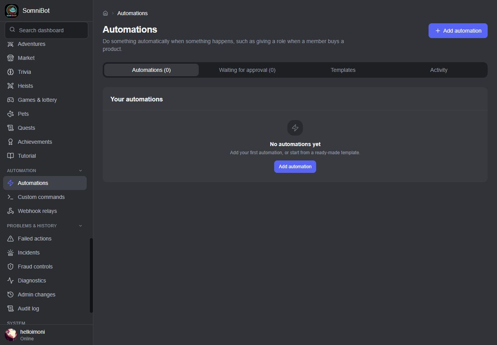

## Channels and messages

- **Scheduled messages**: a reminder, a rules link or a daily tip, on any schedule.
- **Embed builder**: make message cards with text, sections, pictures, galleries and
  link buttons, then send them to a supported channel or use them in a scheduled
  message. Saved classic embeds keep sending as before until you edit them.
- **Temp channels**: a hub voice channel that gives each member who joins their own
  voice room, which they can lock, unlock or claim with `/voice`. Each room only offers
  the sound quality your server allows and copies the access rules of its category, so a
  room in a members-only or 18+ category stays closed to everyone else.
- **Stats channels**: a live number, such as your member count, shown as a voice
  channel's name.
- **Emoji picker**: wherever an emoji is chosen, one picker offers this server's own
  emoji and the standard ones.
- **Reaction roles**: members give themselves roles with reactions or buttons.

## Staying in control

- **Save badges**: after every save, a badge says what the running bot did with it.
- **Admin changes**: changes made from the dashboard and by the bot, each with an undo
  button where it can be undone, saying what it will put back.
- **Sync**: changes made directly in Discord, outside SomniBot, with **Restore SomniBot's
  version** or **Keep Discord's version**. It checks every few minutes and can put things
  back by itself.
- **Snapshots**: saved copies of every role, channel and permission, plus the server's
  settings, emoji, stickers, soundboard sounds, bans and which roles each member has.
  SomniBot saves one before each big change, once a day by itself (you can change how
  often, or switch it off) and shortly after roles or channels change, and saves nothing
  when nothing has changed. You can also save one yourself at any time. When something
  looks like a mass change, the bot keeps the last good snapshot safe. Any snapshot can be
  **downloaded** to a file and **restored from a file** later; the file is checked before
  it loads, and a preview shows what would change before anything does.
- **Full restore**: **Restore** compares a snapshot with your server first, and nothing
  changes until you confirm. Roles, channels and permissions come back. You choose, each
  off until you turn it on, whether to also give members back their roles (it never
  takes a role away from anyone), put the server's settings back, re-create missing
  emoji, stickers and sounds (as many as the server has room for), put back bans that
  were lifted (never for members staff pardoned since), and remove what wasn't there when the snapshot was taken, which lists
  exactly what it would delete and needs a second confirmation. Reaction roles, ticket
  panels, level rewards, store roles and every other setting that used something
  re-created are pointed at the new one. A restore can be undone from **Admin changes**.
- **Backups**: saved to this PC, a USB stick or an external drive, on demand or
  automatically. A backup holds every snapshot with the rest of SomniBot's data, plus the
  Launcher's own settings and keys, so a new PC restores in one step. The settings and keys
  inside a backup are encrypted. You can also send an extra copy of each backup to your own
  Nextcloud; if that copy fails, the local backup is kept and you are told.
- **Move SomniBot to a new server**: if your server is deleted or lost, make a new one,
  invite the bot and press one button. While the old server still exists, the move copies
  it as it is at that moment. If it is gone, SomniBot builds the roles, channels,
  permissions, settings, emoji, stickers and sounds from a snapshot you choose, with
  channel and role order coming across exactly as shown. Discord's default starter
  channels are not copied, and before it deletes anything in the new server, the move
  lists what and asks you first. It moves everything it
  remembers (settings, levels and wallets, purchases and the store, tickets, automations)
  to the new server, points every setting at the new roles and channels, and posts the
  ticket, role, rules and verify panels again. Home shows how far it is, and if it
  stops, it says what to do and carries on from where it stopped without building
  anything twice. Members who join the new server get back the roles they held at the
  moment of the move, and so do people already in it. Messages in the old server, bans,
  other bots and webhooks, Community features, and anything that needs more boosts than
  the new server has can't be carried
  over, and a message at the end lists exactly what. Programs built for buyers to sign in
  with Discord name the old server, so those need a new build. While the old server still
  exists, the bot invites every member to the new one by DM, and the invite names the
  server they already know. It also posts that invite in an announcement in the old
  server (on by default). Members can also add the app to their Discord account in
  one click from the verify panel, `/help` or `/privacy`, so a move can still reach them by
  DM if the server is ever deleted. A permanent "find us again" link on your own web address
  (`/join`) always leads to the current server and follows a move. It also works to make a
  copy while your old server still exists; apart from that announcement, nothing in the old
  one is changed.
- **Members**: everyone, with a timeline per member (joins and leaves, the member gate,
  role changes the bot made, purchases, refunds, tickets, cases, appeals, level-ups and
  game money,
  always labelled as game money).
- **Failed actions**: anything the bot couldn't do, to replay or dismiss.
- **Incidents**: problems being worked on, each with a timeline. SomniBot opens one by
  itself for a critical alert or a burst of fraud signals.
- **Diagnostics**: whether each part of SomniBot is working, and the problems it raised.
- **Audit log**: everything that happened on your server, who did it and when, with
  filters and downloads.
- Switching a feature off also hides its slash commands in Discord.

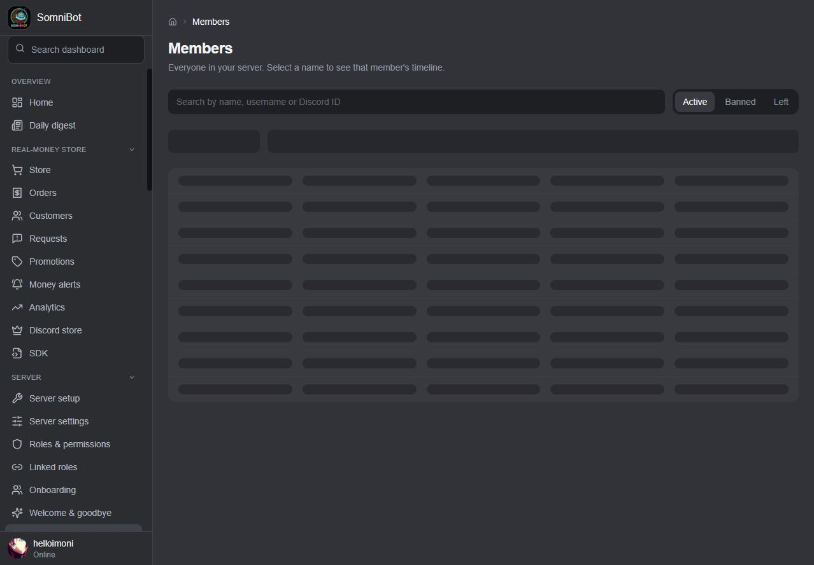

## Owner alerts and the daily digest

When something needs you (music stopped, a lost permission, a channel that's gone, the
bot can't do something it was asked to, the member gate needs a choice), SomniBot sends
you an **owner alert**, by DM or in a channel members can't read. Store alerts have
their own page and channel. The first time the bot starts, it also sends you one DM
with your next steps.

SomniBot also looks after itself where it can:

- The bot watches its own role position and permissions and tells you at once what
  stopped working. Alerts close themselves when the problem is fixed.
- **Check again** re-runs the checks on demand, including the PayPal comparison and the
  deleted-channel checks.
- If a channel that one of your settings uses is deleted, you get a plain alert.
  **Sync → Restore** brings the channel back in its old place and points every setting
  at it.
- Ticket, role and rules panels are posted again if someone deletes them.
- Common problems are repaired by SomniBot itself, such as a Discord switch it needs
  being turned off or the public address breaking. Anything it can't fix comes with a
  plain alert.
- Staff are told when a member with an open ticket leaves, and the member is added back
  when they return.
- At start the bot waits for its database and retries Discord instead of giving up. If
  something still stops it, the Launcher shows the real reason (your bot token was
  refused, the bot can't reach Discord or the database, or it keeps stopping) and what
  to do.
- While the bot starts its features after a restart, a member who uses one is told it is
  still starting, not that it is broken.
- The bot stays responsive under heavy load: the assistant's search runs in its own worker,
  so it doesn't hold up the rest of the bot.
- The Launcher warns when the computer's free disk space drops under 5 GB, and again under
  1 GB, before a full disk can stop the database. It can start with Windows and keeps
  running in the tray when its window is closed, so the disk watch and automatic backups
  keep working. It installs Tailscale, Docker and any Linux parts it needs by itself, keeps
  the PC awake while SomniBot runs, and runs backups and updates by themselves. It looks
  for a new version about once an hour, retries a short failure (such as no internet for a
  moment) at the next look, and switches back to the version before if a new one fails its
  health check.
- Every update keeps a copy of your database from just before it. **Settings → Backups**
  lists these copies, and **Restore** puts one back after saving your current data first.
  Backups are read back after they are saved, so a damaged one is caught at once. A
  scheduled backup that falls due before Docker is ready after the PC starts waits
  instead of failing.
- While SomniBot is stopped, Home has a **Start** button in its status card.
- The Launcher has a **Health** page that says in plain words what is working, what needs
  attention and what to do next: a service that isn't running, a backup drive that is
  missing, or a backup that failed. If the backup drive is missing, SomniBot keeps
  running.
- **Save support bundle** writes a text file on your computer with the Launcher's log and
  status, with known secrets removed. It never uploads anything; you choose whether to
  send it to anyone.

The **Daily digest** sends one message a day, at the time and timezone you choose, to
your DMs or a staff channel. It covers new members, sales, tickets, requests, failed
actions, moderation, and bot and music health. You can preview the next one, and choose
whether quiet days still get a short note. A **weekly trends report** can be added, sent on
the day you choose to the same place.

**Alert routes** let you choose, for each level of seriousness, a staff-only channel, roles
to ping and whether the owner also gets the alert by DM.

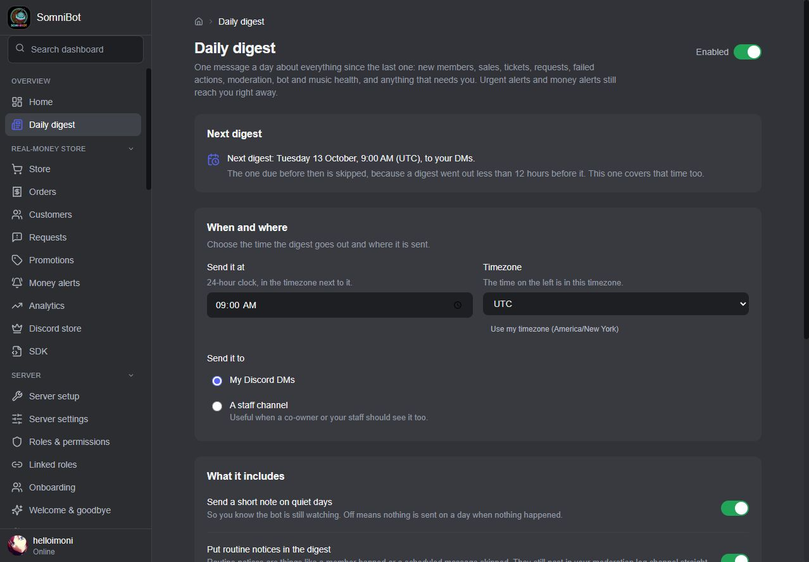

## Search, reports and insights

- **Search everything** (press Ctrl K, or Cmd K on a Mac, from any dashboard page) finds
  pages, settings, commands, handbook topics, products, customers, members, channels,
  incidents and audit entries, and opens the right place. Each person only sees what their
  permissions allow.
- **Owner reports** holds the daily digest, the weekly trends report and the alert routes
  above, with a preview of the next one.
- **Member insights** shows the last 30 days: how many active members came back on another
  day, the busiest hours (in UTC), top channels, member journeys and early signs that
  someone may leave. They are leads for you to look into, not automatic actions. It keeps
  counts only, never message text.
- **Owner handbook**: short, task-based help (what do you want to do?) that dashboard pages
  can link straight to.
- **Member changelog**: a page members can read that lists what changed, in plain words.

## Your team

Give other people access to the dashboard with **dashboard roles**. No role is built in:
start from a template (**Admin**, **Moderator**, **Finance**, **Support**) or an empty
role, then choose each permission. Permissions cover server settings, moderation,
tickets, automations, roles and channels, editing products, running the store, handling
orders, customers (program PCs included), analytics, the audit log, Diagnostics, incidents,
fraud, failed actions, undo, the team page and the coin economy.

- A team member sees only the pages their permissions cover. A save that would also
  change something outside them is refused whole.
- Someone who manages the team can only hand out roles that rank below their own. If
  they try more, it's refused and you get an alert.
- Some things stay the owner's alone: Settings, the Daily digest, the store's brand
  name, and where owner alerts go.
- By default, invitations are sent by Discord DM and must be accepted; they expire after
  24 hours, 3 days or 7 days.
- Team members sign in with their own Discord account, from any device.

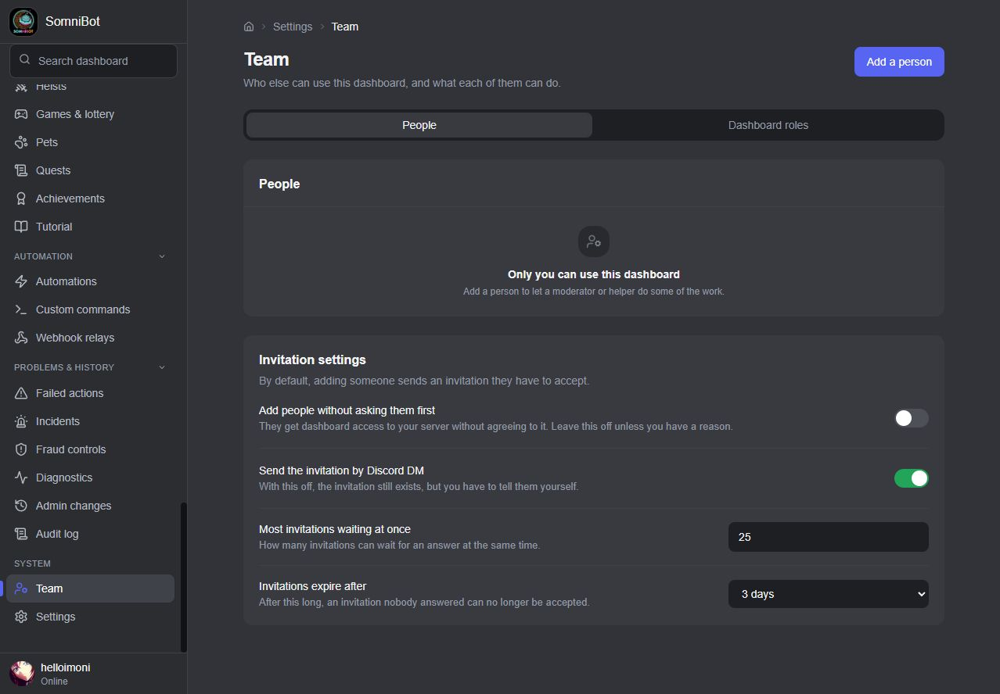

## Languages

SomniBot speaks **English, Spanish, Portuguese, French, German and Russian**, and the
slash command descriptions are translated too. Under **Settings** you choose whether the
server uses one language for everyone, or each member picks their own. A member picks with
`/language`, or chooses Automatic to follow their Discord language. The **Translate** and
**Translate my reply** right-click commands are separate: they translate single messages.

## Privacy

Members manage their own data in Discord:

- `/privacy` shows what SomniBot keeps about them in your server, how long each kind of
  record is kept, and how to reach you.
- `/mydata` sends them a file of their data, once a day at most (you can switch it off).
- `/forgetme` erases or anonymizes their data after they confirm, and lists first what is
  erased and what is kept. Moderation history stays: completed records lose the member's
  ID and name, while an active warning, timeout or ban keeps its ID until it is over.
  Saved ticket transcripts and messages already posted in Discord stay until deleted
  by the owner or staff.

You choose how long records are kept, from 30 days to 10 years. Orders and payments are
kept as your sales records.

---

[← Back to the overview](README.md) · [The store](STORE.md) · [Commands](COMMANDS.md)
