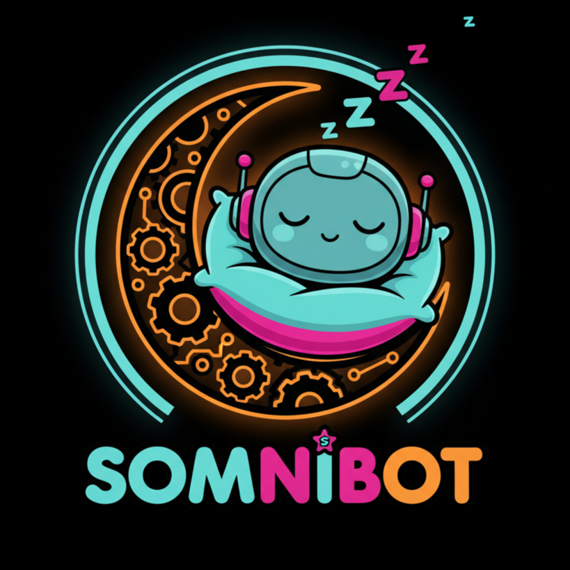
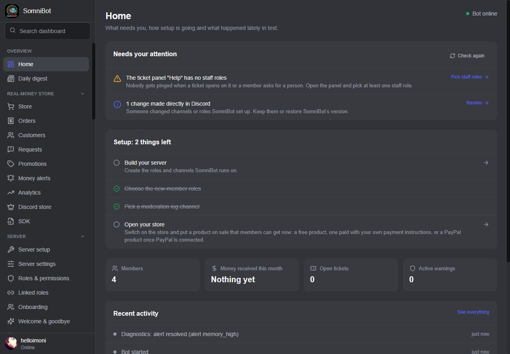
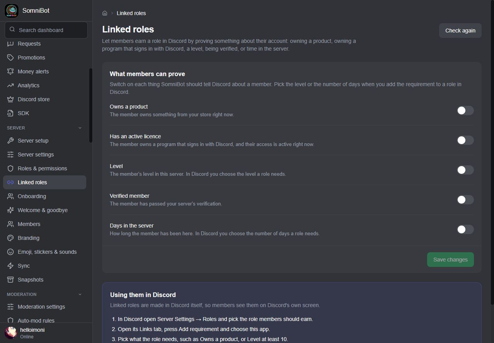
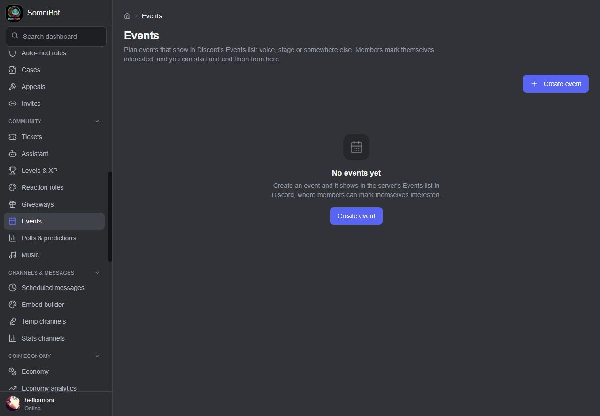
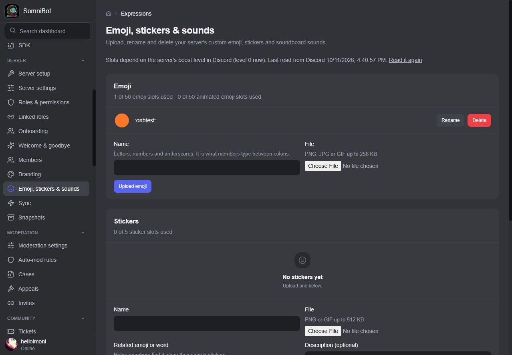
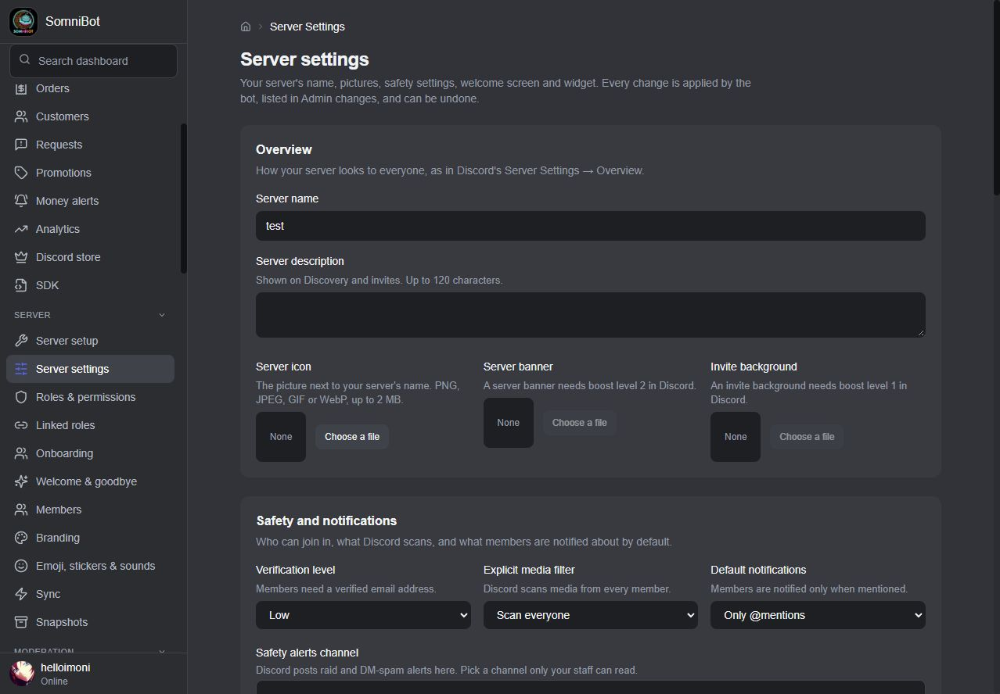
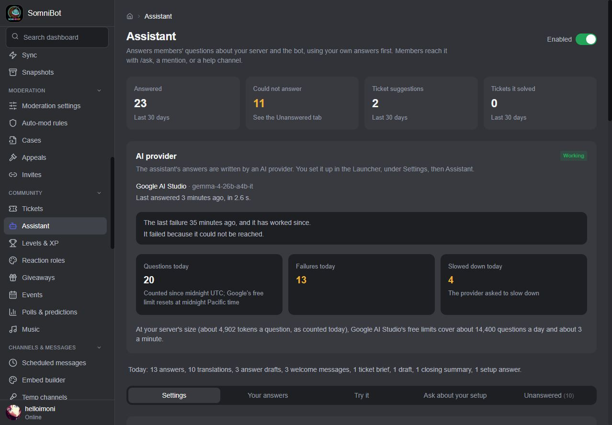
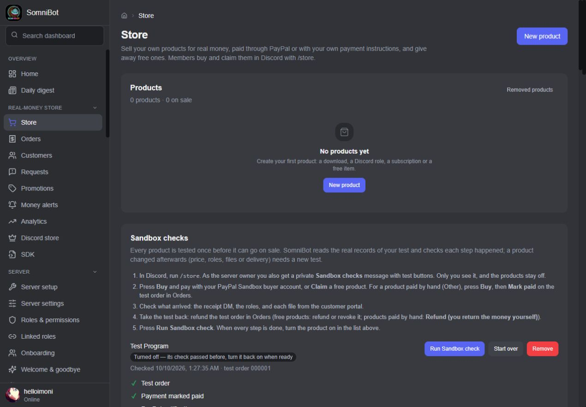
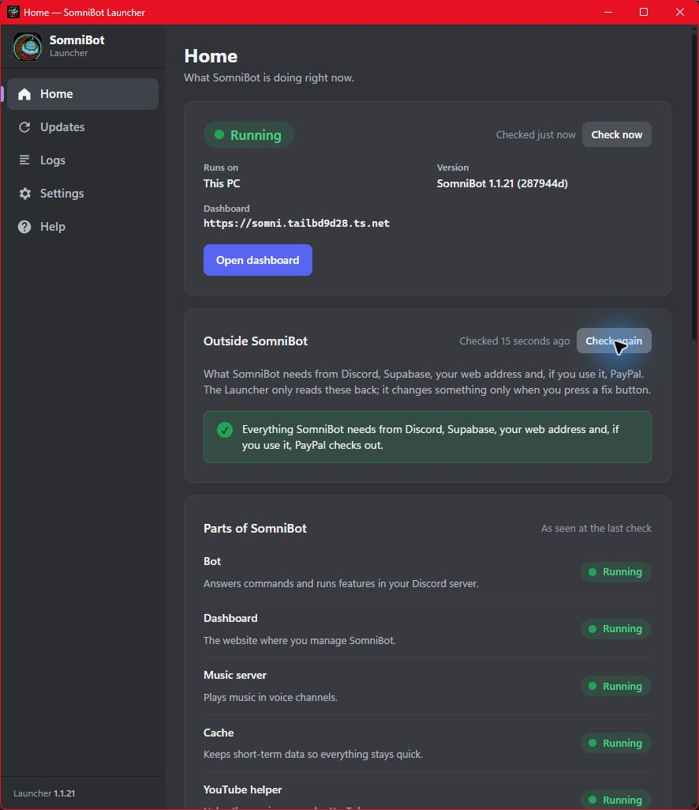
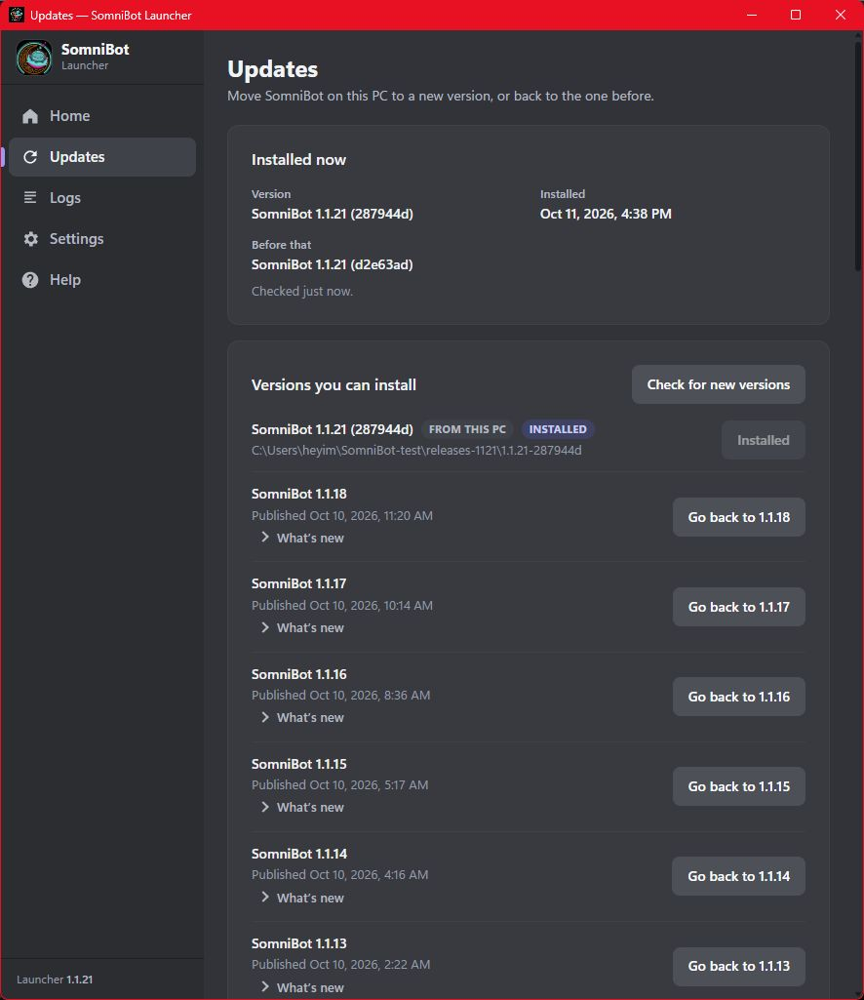

  

<h1 align="center">SomniBot for Discord</h1>

  <b>One Discord bot for your whole server: member gate, moderation with anti-nuke protection, automatic server snapshots, levels, a coin economy with seasons, pets, clans and games, giveaways, tickets, an assistant that answers your members, music, automations, and a real-money store with Discord-based licensing for programs and a customer portal.</b> 
  All of it is run from one web dashboard, under your own bot's name and brand.

  <a href="FEATURES.md">Features</a> ·
  <a href="STORE.md">The store</a> ·
  <a href="COMMANDS.md">Commands</a> ·
  <a href="#how-it-runs">How it runs</a> ·
  <a href="#contact">Contact</a>

---

> This repository is a showcase. It describes what SomniBot does and contains no code,
> downloads or install files. The screenshots come from a real SomniBot install, with
> sample data and sample product names.

## What's new in 1.1.60

**Current version: 1.1.60.** Highlights since the last showcase update:

- **Seasons and battle passes.** Each season has its own pass with free and premium
  tiers, quests, a daily login calendar and a badge, and four ready-made seasons come
  with every server.
- **A much bigger play-money world.** Pets that evolve and go on expeditions, clans with
  a shared bank and wars, collectible cards, an RPG with classes and dungeons, fictional
  stocks and crypto, houses and businesses, jobs, loans, auctions and more.
- **Games to play together.** Multiplayer blackjack and Texas Hold'em, bingo, chess,
  connect four, hangman, Wordle and more, a music quiz in voice, party adventures, crew
  heists and a weekly boss raid for the whole server.
- **Better tickets.** Priority, saved replies, moving a ticket to another type, first
  response targets with reminders, and a stats page.
- **Stronger moderation.** Moderator notes, case reasons that keep their history, CSV
  downloads, moderator activity, more log channels, a panic button, a question or captcha
  step on the member gate, and new auto-mod safety rules for scam links, attachments,
  emoji, distorted text and your own patterns.
- **Faster setup.** Eight ready-made starter layouts in Server setup, and a search box
  (Ctrl K) that finds any page, setting, command, member or channel.
- **More for communities.** Social feeds, free-game alerts, suggestions, confessions,
  birthdays, utilities, tiered starboards, and music with lyrics, search, playlists and a
  24/7 mode.
- **Six languages**: English, Spanish, Portuguese, French, German and Russian.
- **A broader store.** Optional Stripe payments, stock counts, subscription limits,
  bundles, supporter tiers and richer analytics.
- **Owner tools.** Weekly reports, alert routes, member insights and an owner handbook,
  plus a Launcher with a Health page, encrypted settings in backups, an optional
  Nextcloud copy and a support bundle you save yourself.

## Why SomniBot

- **Your bot, your brand.** SomniBot is white-label. Members talk to the bot *you* create
  in the Discord Developer Portal, with your name and picture, and you can give it its
  own name, picture, banner and About me in each server. The bot's messages, the
  store and the customer portal use your brand name, logo, colours and voice. The only
  mention of SomniBot members see is a small "Powered by SomniBot" footer, and you can
  switch that off.
- **One dashboard for everything.** About 90 dashboard pages, grouped into Overview,
  Real-money store, Server, Moderation, Community, Channels & messages, Coin economy,
  Automation, Problems & history and System. A search box (Ctrl K) finds any page,
  setting, command, member or channel.
- **You always know what happened.** After every save, a badge says what the running bot
  did with it: Saved, Applying…, Applied, Not applied (with the reason), or "Bot offline,
  applies when it starts". **Admin changes** lists changes made from the dashboard and by
  the bot, with an undo button that says what it will put back.
- **It never surprises you.** The bot never makes a role or channel nobody asked for.
  Big changes are previewed before anything happens in Discord, and SomniBot saves a
  snapshot of your server before each big change it makes. It also stops before opening
  a staff-only channel to members, because they would see every earlier message in it,
  and asks you to choose first.
- **Ready for a bad day.** Anti-nuke protection steps in when one account starts
  wrecking the server. Automatic snapshots let you put your roles, channels and
  settings back after a mistake. If the whole server is lost, SomniBot can rebuild it
  in a new one. The bot also notices and fixes some of its own problems, and tells you
  plainly about the rest.
- **Real money and play money never mix.** The coin economy is a game. No store product
  gives coins, coins can't be turned into real money, and a role someone paid for never
  earns coin income.
- **A team, not just you.** Give staff dashboard roles built from templates (Admin,
  Moderator, Finance, Support) or from scratch, permission by permission. Each person
  sees exactly the pages their permissions cover.

## A tour

### Build your whole server in seven steps (or start from a ready-made layout)

**Server setup** designs your roles (in Admin, Moderator, Support, Member and Cosmetic tiers) and
your categories and channels, shows every change before it happens, then creates them in
Discord along with Discord's server settings, the AutoMod spam and slur filters and
Community. The deploy is safe by default: it only touches roles and channels SomniBot made,
and keeps everything you made yourself. A last step lists exactly what to check with a
test account.

Not sure where to begin? Load one of eight **starter layouts** (Community, Gaming,
Creator, Store, Support, Study, Roleplay or 18+ community) and change whatever you like
before anything happens in Discord.

On a server that already has its own channels and roles, you can also choose to remove
the ones that aren't part of the new layout. It is off by default, and only the owner
sees it. Turning it on lists exactly what would be deleted, SomniBot saves a copy of the
server first, and a second confirmation is needed. Anything the layout uses, and anything
Discord or SomniBot needs, is never removed.

### More of Discord in one dashboard

Plan forum, media and stage channels, choose access for specific roles and load a
server template. Manage **Server settings** (which also shows whether 2FA for moderator
actions is on, and where you turn it on in Discord), role icons, gradients and colours,
which roles show separately in the member list, **Events**, **Emoji, stickers & sounds**,
voice moderation and Discord's own polls. The pages
explain Community, boost and other Discord requirements before unavailable choices
can be applied.

**Linked roles** shares product ownership, an active program licence, verification,
level and days in the server for requirements you choose in Discord. The Launcher
checks the verification setup first. Members can also install the app to their own
accounts for `/portal`, `/privacy` and `/mydata` in their DMs with the bot and in group chats.

Branded Discord message cards (Components V2) combine text, pictures and controls.
See [all features](FEATURES.md) and the [command list](COMMANDS.md).

### A member gate that lets the right people in

New members get an Unverified role the moment they join and can only open the rules,
verification and support channels. When they finish your steps (accept the rules, pick
roles, answer Discord's onboarding questions if you want), they get the Verified role
and the rest of the server. You can add a **question** or an **image captcha** to the
steps. Nobody is let in by a timer, and staff can verify or unverify anyone from Discord
or the dashboard.

Every channel gets a purpose (staff-only, 18+, read-only, normal chat), and **See the
server as a role** shows, channel by channel, what someone holding any set of roles can
do, with a fix for anything that doesn't match.

### Moderation, auto-mod and one-click lockdown

Warnings, timeouts, kicks and bans with automatic punishment steps, cases, appeals,
message logging, anti-raid and a starboard. **Lockdown** stops members posting, reacting
and speaking everywhere at once during a raid, and **Unlock** puts every channel back
exactly as it was, even after a restart. A **panic button** does it in one press from the
dashboard or `/lockdown panic-start`, and opens an incident for staff.

Staff can keep **moderator notes**, edit a case's reason without losing the earlier
wording, download cases and notes as CSV, see what each moderator did over a period,
and send role, channel, voice, invite, nickname and avatar changes to log channels.

Auto-mod rules filter words, links, invites, spam and mass mentions. **Safety rules** add
scam and phishing links, attachments, emoji spam, distorted (Zalgo) text and your own
text patterns, each limited to the channels and roles you choose. **Try a rule safely**
tests a sample message without acting on it. A **Translator** rule rewrites words
instead of blocking them, and never punishes anyone.

### Protection when something goes wrong

**Anti-nuke** is for the day an account goes wrong: a staff member's hijacked account, a
bad bot, or a mistake. It is on from the start. The bot reads Discord's audit log as
things happen and counts what each person does within a minute: channels or roles
deleted, members banned or kicked, webhooks created, powerful permissions handed out,
bots added, or the server name or vanity link changed. When someone passes the limit
you set, the bot saves a snapshot, takes powerful permissions back off the roles they
were given, deals with the person the way you chose (take away their powerful roles,
add a 24 hour time out, kick them, or only tell you), and sends you one critical alert
that points to the snapshot from before it started. You choose the limits, and the
people and roles that are trusted. It never acts on the server owner or on the bot
itself, and it can only act on someone whose top role is below the bot's: if not, the
alert says exactly that.

**Automatic server snapshots** keep saved copies of your roles, channels and
permissions, plus the server's settings, emoji, stickers, soundboard sounds, bans and
which roles each member has. SomniBot saves one before each big change, once a day by
itself and shortly after roles or channels change, and saves nothing when nothing has
changed. **Restore** shows you what would change before anything does. Roles, channels
and permissions come back, and you choose whether to also give members back their
roles, put the server's settings back, re-create missing emoji, stickers and sounds,
and put back bans that were lifted. Reaction roles, ticket panels, level rewards, store
roles and every other setting that used something re-created are pointed at the new
one, and a restore can be undone from **Admin changes**. Any snapshot can also be
downloaded to a file and restored from that file later, so you can keep a copy outside
SomniBot.

**Lost your server? Move SomniBot to a new one.** Make a new server, invite the bot and
press one button. While the old server still exists, the move copies it as it is at that
moment. If it is gone, SomniBot builds the roles, channels, permissions and settings
from a snapshot you choose, with channel and role order coming across exactly as shown.
Discord's default starter channels are not copied, and before it deletes anything in the
new server, the move lists what and asks you first. It moves everything it remembers
(levels and wallets, purchases and the store, tickets, automations) across, posts the
ticket, role, rules and verify panels again and gives members back the roles they held at
the moment of the move, including people already in the new server. Messages in the old
server, bans, other bots and webhooks, Community features, and anything that needs more
boosts than the new server has can't be carried over, and SomniBot lists exactly what at
the end. It also works as a copy when your old server still exists. While the old server
still exists, the bot invites every member to the new one by DM, and the invite names the
server they already know. It also posts that invite in an announcement in the old server
(on by default). Members can also add the app to their Discord account in one click from
the verify panel, `/help` or `/privacy`, so a move can still reach them by DM if the
server is ever deleted. A permanent "find us again" link on
your own web address (`/join`) always leads to the current server and follows a move.

### Levels, a full coin economy and giveaways

Message and voice XP, level rewards (roles, coins or items), XP multipliers, rank cards,
profile cards and leaderboards for XP, messages, voice time, coins, trivia, fish and
more, by week, month or season, with a public web page and a profile page members open by
signing in with Discord. Voice XP is earned only for real activity: not muted or deafened, with
someone else in the room. Lowering a member's XP takes their level reward roles back.

A whole play-money game: daily, weekly and monthly rewards, jobs, work and crime, banks
with interest and loans, robbing, role income, a game shop, a member-to-member market with
auctions and trades, crafting, farming with animals, fishing with an aquarium, hunting,
digging, mining, chopping and foraging, adventures, heists, pets, quests, achievements,
prestige, trivia, lotteries, predictions and casino-style games, including roulette,
crash, races and duels. The games pay back about 95% of what is bet over time, and you can
cap bets and daily losses. Lotteries pay the winner 90% of the pot and burn the rest,
predictions can close at a set time or be cancelled with every bet refunded, and
`/casino highlow` is a cash-out ladder: each right call climbs a rung, up to ×12, and
members can stop and cash out on any rung.

Giveaways with a button to enter, optional role and level requirements, and prizes that
can be products from your store.

### Seasons, clans, cards and a world to play in

**Seasons** give your server a rhythm: each has its own battle pass with free and premium
tiers, quests, a daily login calendar and a badge, and four ready-made seasons are
included. Around them sit **pets** that evolve and go on expeditions, **clans** with their
own role, private channel, bank, quests and wars, **collectible cards** with sets and
trades, an **RPG** with four classes, gear, a skill tree, dungeons and an arena,
**fictional stocks and crypto** whose prices follow your server's activity, and **houses
and businesses** that earn income and defend against robbers. All of it is play money
and play progress, never for sale.

Members can also play together: multiplayer **blackjack and Texas Hold'em**, **bingo**,
**tic-tac-toe, connect four and chess**, **hangman, Wordle and word chain**, a **music
quiz** in voice, 2 to 4 player **party adventures**, three-role **crew heists**, and a
**weekly boss** the whole server fights.

### An assistant that knows your server

Members ask in plain words, with `/ask`, by mentioning the bot or in a help channel, and
get a real answer: your rules, how to get a role, what a feature pays, when your next
event is. It answers from your server's own words as that member sees them: its
channels and roles, the features you switched on, the rules and info posts your team
wrote, pinned messages, your welcome screen and onboarding questions, your events and
your own written answers. It never names a channel they can't open, and says plainly
when it doesn't know, with a ticket button so a person can take over. It also briefs your staff on
new tickets, drafts replies, summarises transcripts, translates, and explains your own setup
to you. You bring a free key from Google, Cloudflare or Groq (or any compatible AI service);
the Launcher walks you through it. Its search runs on its own, so the bot stays responsive
under heavy load. When the AI service is busy or down, the assistant waits and asks again,
and questions it could not answer because of an outage don't fill your list of unanswered
questions: you see one line about the outage instead.

### Tickets with buyer context

Ticket panels with buttons or a dropdown, private threads, ticket types with their own
intake questions, claim and unclaim buttons, reopening, reminders, auto-close, feedback and
transcripts. Tickets have a **priority**, staff can use **saved replies** and **move** a
ticket to another type, each type can have a **first response target** with reminders and
escalation, and a **stats page** shows ratings, response and resolution times, and
what each staff member handled. If nobody holds a staff role yet, the server owner and administrators are
brought into the ticket and told, so a ticket never goes unseen. Staff are told
when a member with an open ticket leaves the server, and the member is added back to
the ticket if they return. When a buyer opens
a ticket, staff see their orders, the PCs they activated your programs on and their
open requests right there, and can reset PCs, start a refund or remove access from
Discord.

### A real-money store inside Discord

Sell digital products from `/store`: programs that check the buyer's Discord account,
downloadable files, roles and channels, service tickets, subscriptions and free
products. A product can have a stock limit and a limit per member, and can show how many
are left. Plans can have subscription limits and supporter tiers, and products can be
bundled. Buyers pay through **your own PayPal**, **your own Stripe** (optional), or **your
own way** (crypto, Cash App, a bank transfer) and you confirm the payment. Every product passes a Sandbox test
purchase before it can go on sale. Buyers get a branded customer portal for their
programs, downloads and orders. A buyer who left the server before delivery gets their
order when they come back, and a PayPal dispute keeps access in place until PayPal
actually takes the money back.

Selling a program? **Discord is the licence.** The program signs the buyer in with
Discord and checks their role in your server every time it starts, so a refund ends
access, with no licence keys to hand out or lose. The dashboard's **SDK** page writes
the instructions your developer, or an AI coding assistant, follows to add the check.

Read the full tour in **[STORE.md](STORE.md)**.

### Automations

"When this happens, if these conditions hold, do these actions." Triggers cover members,
the store, moderation, messages and activity, tickets and giveaways; actions include
messages and DMs, roles, threads, tickets, granting a product and moderation.

### Music

Music in your voice channels from YouTube, SoundCloud, Bandcamp and Twitch, with a DJ
role, vote-to-skip, queue limits, audio filters and auto-leave. `/autoplay` keeps related
songs coming when the queue runs out, `/previous` plays the last song again and `/skipto`
jumps ahead. `/music lyrics` shows lyrics, `/music search` lets members pick from a list,
`/music 24-7` keeps the bot in voice, and `/music playlist` saves server and personal
playlists.

### Community, feeds and extras

**Suggestions** with voting and a staff review flow, anonymous **confessions**,
**birthdays** with a role and a calendar, **reminders, tags, to-do lists and sticky
notes**, social commands such as hugs, 8-ball and rep points, and **starboards** with tiers
and a monthly best post. **Feeds and alerts** post new videos, streams, posts, RSS items
and anime episodes from Twitch, YouTube, Kick, TikTok, Reddit, Bluesky and X, plus
**free-game alerts** for Epic and Steam. **Extras** add text to speech, a soundboard,
meme and quote cards, counting and word-chain channels, seasonal events, signed outbound
webhooks and a read-only public API.

### Six languages

Members can use SomniBot in **English, Spanish, Portuguese, French, German or Russian**.
You choose one language for the whole server or let each member pick with `/language`.

### Your morning briefing

The **Daily digest** sends you one message a day about everything since the last one:
new members, sales, tickets, requests, failed actions, moderation, bot and music health,
and anything that needs you. A **weekly trends report** can be added, and **alert routes**
send each level of alert to the staff channel and roles you choose. **Member insights**
shows retention, busy hours, top channels and early signs that members are drifting away.
Urgent alerts and money alerts still reach you at once.

### Every member's story in one place

**Members** lists everyone with their level, coins and access. Open a member to see
their timeline: joins and leaves, the member gate, role changes the bot made, purchases,
refunds, tickets, moderation cases and appeals, and level-ups.

### Your team

See everything in **[FEATURES.md](FEATURES.md)**, and every command in
**[COMMANDS.md](COMMANDS.md)**.

## How it runs

SomniBot is self-hosted: it runs on a server (VPS) or on your own PC, and your data stays
in your own database. You sign in and make the choices that are yours; the rest of the
setup is done for you. The **SomniBot Launcher** (Windows and Linux) installs it, along
with Tailscale, Docker and any Linux parts it needs, checks everything it needs from
Discord, the database, your web address and PayPal, starts and stops it, updates it, and
rolls back to the version before. Ubuntu and Debian owners get a normal `.deb`
installer that brings everything it needs; the AppImage is for other Linux.

- **Problems explained in plain words.** When something stops working, the Launcher
  shows the real reason and what to do about it: your bot token was refused, the bot
  can't reach Discord or the database, or it keeps stopping. At start the bot waits for
  its database and retries Discord instead of giving up. While SomniBot is stopped, Home
  has a **Start** button right in its status card. A **Health** page says what is
  working and what needs attention, and **Save support bundle** writes a text file with
  the log and status, secrets removed, on your own computer. Nothing is uploaded.
- **It looks after itself.** Ticket, role and rules panels are posted again if someone
  deletes them. If a channel that a setting uses is deleted, you get a plain alert, and
  **Sync → Restore** brings the channel back in its old place and points every setting
  at it. The bot watches its own role position and permissions, and tells you the
  moment something it needs is taken away. Alerts close themselves when the problem is
  fixed. **Check again** re-runs the checks on demand, including the PayPal comparison and
  the deleted-channel checks. SomniBot also repairs common problems by itself, such as a
  Discord switch it needs being turned off or the public address breaking, and tells you
  plainly about anything it can't fix.
- **Backups and updates on their own.** The Launcher backs up the database before every
  install and update, and backups run by themselves too. It looks for a new version about
  once an hour. Updates install by themselves: checks, the download, the backup and
  database changes all happen before anything running is touched. If the new version
  doesn't pass its health check, the Launcher switches back to the version before on its
  own. A short failure, such as no internet for a moment, is tried again at the next look.
  Every update keeps a copy of your database from just before it, and **Settings → Backups**
  lists those copies with a **Restore** button for each. Saved backups are read back to
  check they are good. The Launcher's own settings inside a backup are encrypted, and an
  extra copy of each backup can go to your own Nextcloud. If you're sent a version
  by hand, put its files in one folder and press **Use update files from this PC** on the
  Updates page. The full guide comes with the Launcher, readable offline.
- **No ports to manage.** Nothing in SomniBot uses a fixed port. The Launcher picks free
  ones, and if another program takes one later it moves SomniBot to a free port by
  itself and says so on Home. If your PC's Tailscale name changes, it follows the new
  name, moves the public addresses and shows the new sign-in addresses to add in
  Discord.
- **Your data, portable.** Export everything (every table and every uploaded file) to
  one file, and import it on another machine or database. Backups can be saved to this
  PC, a USB stick or an external drive, on demand or automatically, and include the
  Launcher's own settings and keys, so a new PC restores in one step.
- **Warned before the disk fills.** The Launcher watches free space where SomniBot runs.
  Under 5 GB free, Home shows a warning and you get a desktop notice; under 1 GB the
  warning turns red. A full disk stops the database, so you hear about it first. The
  Launcher can start with Windows and keeps running in the tray when its window is closed,
  so the disk watch and automatic backups keep working.
- **Your database, your choice.** A Supabase project, your own Supabase, or a database
  the Launcher runs for you on the same machine.
- **Reachable from anywhere.** The Launcher gives the dashboard a public web address
  with Tailscale Funnel, or you use your own domain. You and your team sign in with
  Discord from any device. While SomniBot runs on your PC, the PC stays awake, so the bot
  stays online.

## Contact

Interested in SomniBot, or have a question? Message me on Discord: **@helloimoni**

---

Discord is a trademark of Discord Inc. SomniBot is not affiliated with or endorsed by Discord.

