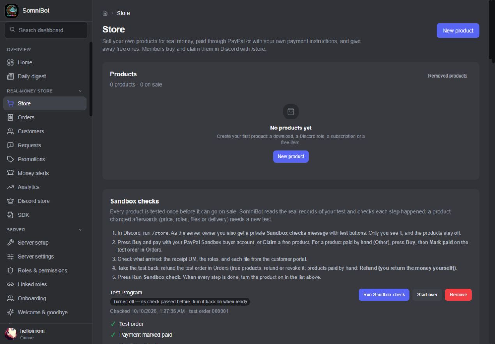
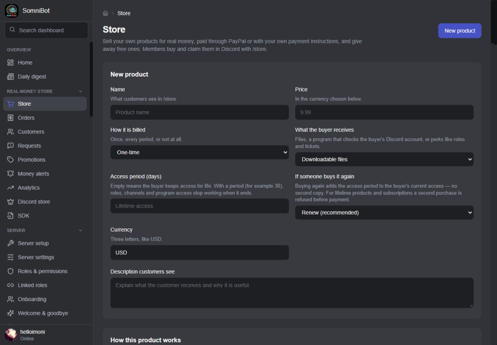

# Sell from your Discord server

[← Back to the overview](README.md) · [Features](FEATURES.md) · [Commands](COMMANDS.md)

SomniBot includes a real-money store for **digital products**, run entirely from your
Discord server and dashboard. It is completely separate from the coin economy: coins
can't buy store products, and store products never give coins.

The screenshots on this page come from a real SomniBot install with sample product
names.

## How buyers pay

- **Through your own PayPal account**: card and PayPal payments, and subscriptions.
  The money goes to you; SomniBot connects to your own PayPal apps.
- **Through your own Stripe account (optional)**: card payments and subscriptions through
  Stripe Checkout. Stripe starts in **test mode**. You add its keys in the Launcher and
  connect its webhook from the Store page, and the switch refuses to turn on until the
  keys, your public address, the webhook and its signing secret are all in place. Going
  live uses the same real-money confirmation as PayPal. A subscription on Stripe uses a
  recurring price you create in Stripe. Retries of the same Stripe event never create a
  second order.
- **Your own way**: for payments PayPal can't take (crypto, Cash App, a bank
  transfer…), a product can be **paid by hand**. You write each way to pay **once**, in
  the Store settings under **Payments** (for example Cash App and Bitcoin, each with its
  instructions), and every hand-paid product picks the methods it offers. The dashboard
  suggests a Cash App and a Bitcoin method to start from. Buyers choose a method, see
  its instructions privately, pay you, and add their payment details: a Cash App buyer
  gives their $Cashtag and the payment ID, a Bitcoin buyer the transaction ID. You get a
  **Payment to confirm** alert and press **Mark paid** (or **Reject**, with a reason the
  buyer reads) either on Store → Orders or with the buttons on the alert in Discord. Mark
  paid asks for the proof that fits the method, and the bot then delivers the order
  exactly as for a PayPal sale. The server owner and staff with the order permission can
  do this, but nobody can mark their own order paid: the server owner or another staff
  member confirms it.
- **How long an unpaid order waits** is yours to set, under **New product defaults** in
  the Store settings. A new product starts as you choose there; by default it is paid by
  hand, needs a payment reference and gives the buyer 3 days to pay. An order whose buyer
  never adds payment details closes on its own after those days. Once a buyer has added
  details, the order stays open for the review time you set (14 days to start with) so
  you can check the money. If the money turns up after an order closed, **Mark paid**
  reopens it when the product can still be sold.
  If a buyer's transaction ID is also on another order, that order and its alert say so
  and name the other order, so one payment can't quietly count twice. `{amount}`,
  `$PRICE` and `{order}` in the instructions are filled in with each order's own total
  (after any coupon) and order number. When you record a refund you made by hand, the
  buyer gets a message about it too.
- **Recurring, by hand**: a hand-paid product can't be a subscription (nothing is ever
  charged automatically). To sell something recurring, make it a one-time product with
  an **access period** and **Repeat buying extends access**. Buyers renew by hand: they
  get a reminder the number of days you set before access ends (3 by default, 0 for no
  reminder) and press **Renew**.
- **Free**: free products are claimed instead of bought, once per customer or
  repeatedly.

Each product picks its own way to be paid: PayPal, by hand or Stripe. A store that sells
only free products and products paid by hand needs no PayPal or Stripe at all. While
**Accept PayPal payments** is off, the Store page hides every PayPal setting behind one
line ("PayPal is off. Switch on Accept PayPal payments to set it up.") and they come back
when you switch it on.

## What you can sell

- **Programs that check the buyer's Discord account.** Discord is the licence. Every
  time your program starts, it signs the buyer in with Discord and checks that they are
  in your server and hold the product's role, so a refund, a chargeback or a lapsed
  subscription ends access at the next start. Each buyer activates each PC once, in the
  customer portal. You choose how many PCs one buyer may use and how long an activation
  lasts. A PC that is already activated keeps running if your store is briefly
  offline. Only you and the staff you allow can free a buyer's PCs (**Reset PCs**).
  There are no licence keys to hand out, rotate or lose.
- **Downloadable files**. Buyers download from the customer portal with a private link
  that works once, and only while they own the product. **PDFs, images and text files
  get a watermark made for each buyer.** Publish a **new version** with release notes,
  and announce it in a channel, by DM to buyers who asked for updates, or both.
- **Discord perks**: roles and channels given while the purchase is active, and removed
  after a refund or revocation.
- **Service tickets**: a private ticket opened with every purchase.
- **Game items** given with a purchase.
- **Subscriptions**: plans billed every so many days, weeks, months or years, with free
  trials, through PayPal (or Stripe). (Something recurring that is paid by hand is a
  timed product that renews when bought again, see above.)
- An optional **access period** (for example 30 days), after which roles and channels,
  and with them access to a program, stop working.
- Optional **limits** on one-time products: how many can be sold in total, and how many
  one member may buy. A buyer who hits a limit sees "Sold out" or "You already bought the
  most allowed", and nobody is charged. A unit comes back if an order is refunded,
  rejected or expires. A product can also show **how many are left** on `/store`.
- **Subscription limits**: cap how many active subscribers a plan can have in total, and
  how many subscriptions one member can hold. A full plan shows as full.
- **Bundles**: a product can include other products. The buyer gets all of them together,
  exactly as they were when the bundle was saved, or none. Subscriptions and game items
  can't be put in a bundle.
- **Supporter tiers**: give subscription plans a tier name and rank to build a ladder of
  supporter levels. Moving between tiers changes what a buyer gets from then on and never
  rewrites access they already have.

## Buying, inside Discord

Members open `/store`, see the products on sale, and press **Buy** (or **Claim** for a
free product). Coupons: buyers press **Use a code**, see privately what it takes off,
then buy; the bot checks every rule again at that moment. A buyer who already has an
unpaid hand-paid order can add a code to it: the order is replaced by one at the new
price, and the old one is closed.

With **Gifting** on, a **Gift** button lets a buyer pick another member of the server
to give a product to, for products paid through PayPal and for products paid by hand
(the buyer pays, the recipient gets the product when you mark it paid). With **Announce
purchases** on, the bot posts "someone just bought..." in a channel you choose. If
that post can't be sent (the channel was deleted, or the bot lost permission to post
there), you get one alert that says what to fix, and it closes itself once a post goes
through.

Everyone who owns something can get your **Customer role**, and loses it when they no
longer own anything. Use it for customer-only channels.

## Test before you sell

The **Sandbox check** is your choice: **Require a Sandbox check before a product goes on
sale** is a switch in the Store settings, and it is off until you turn it on. With it on,
you make a test purchase with test money (or claim it, or mark a by-hand order paid),
check what arrived (the receipt DM, the roles, each file, or your program signed in with
the Discord account that bought it), take it back, and SomniBot reads the real records to
confirm every step happened. A product only goes on sale after that, and changing its
price, roles, files or delivery later needs a new test. With the switch off, a product
goes on sale as soon as you switch it on.

Going live with real money is a deliberate switch, and while the store is in Sandbox,
the customer portal and receipts say so.

## The customer portal

Each store has its own customer portal, in your brand, opened with `/portal` and signed
in with Discord. Buyers find:

- **Licences**: the programs they bought and the PCs they activated them on, with how
  to activate a new one. Buyers can see their PCs but not remove them, so when they run
  out they ask you to reset them;
- **Downloads**: their files, new versions marked as new;
- **Orders**: their order history, payment instructions for orders paid by hand,
  cancelling a subscription (if you allow it), and **Request a refund** or **Contact the
  seller**.

A request never moves money by itself: it reaches you at once and you decide.

## Orders, refunds and access

- **Orders** lists every order with where it came from (a purchase, a giveaway prize, a
  free claim, an automation, or paid by hand), with filters for delivery problems,
  disputes, refunds and more.
- **Refund** asks PayPal to refund the order. Access is removed only once PayPal has
  completed the refund, and it never issues a second refund. Or choose to
  remove access first and refund in PayPal yourself.
- **Refund & Cancel** on a subscription cancels it at PayPal so it can never bill again,
  refunds its latest payment and removes access.
- Refunds made directly in PayPal are handled the same way. A PayPal dispute marks the
  order **Disputed** and alerts you, but the buyer keeps access until PayPal actually
  takes the money back.
- On Stripe, a full refund or a cancelled subscription ends access, and a partial refund
  keeps access and lowers your net revenue and the buyer's lifetime spend.
- A failed delivery shows on its order, with **Retry delivery**.
- A buyer who left the server before their order was delivered gets it when they come
  back.
- You can also refund from Discord, inside the buyer's ticket. For a paid service order,
  staff can set where the work stands (not started, in progress, waiting on the buyer or
  delivered), with a note, and the buyer is told. Staff can also **bill the buyer an extra
  amount** from the ticket: they confirm first, and the buyer gets the invoice in the
  ticket and by DM.

## Keeping track

- **Money alerts**: every sale, refund, dispute, failed delivery, fraud signal and payment
  to confirm, sent to you in Discord, and whether each one reached you. Urgent ones always
  reach your DMs.
- **Customers**: each buyer's timeline (commerce, support and moderation), their portal
  sign-ins, which you can revoke, and the PCs they activated your programs on, with
  **Reset PCs**.
- **Requests**: refund and help requests from the portal.
- **Fraud controls**: suspicious purchases SomniBot noticed, and the rules it uses to
  notice them.
- **Analytics**: payments and refunds for the last 30 days, **monthly recurring revenue**
  by currency, **subscription churn**, a **funnel** for each product (viewed, checkout
  started, paid, delivered and refunded) and each buyer's **lifetime spend after
  refunds**. Different currencies, and test and live money, are never added together.
- **Promotions**: coupon codes for a percentage or a fixed amount off one-time products,
  with minimum purchase, maximum uses, start and end dates, and first-purchase-only (an
  earlier order that was refunded or disputed still counts as a purchase).
- **Discord store**: link premium roles you sell through Discord's own store to your
  server.
- **SDK**: describe your program and SomniBot writes the instructions a developer, or an
  AI coding assistant, follows to add the Discord check to the program you already have:
  four files covering the Discord sign-in, the role check, PC activation and every
  message the program shows. The program asks Discord itself; your store is only asked
  to activate a PC and whether it is still allowed. Nothing on that page changes your
  store.

---

[← Back to the overview](README.md) · [Features](FEATURES.md) · [Commands](COMMANDS.md)
